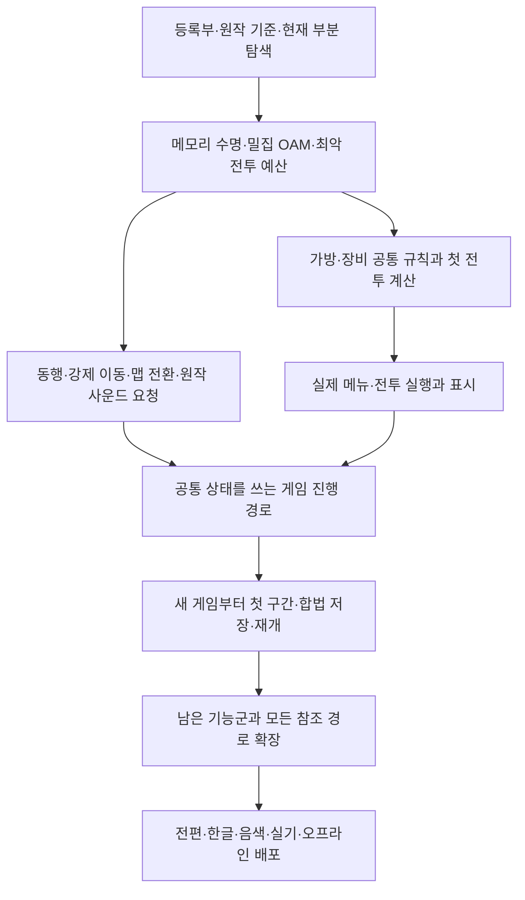

# FF3 한글 GBC 이식: 현재 구현 순서

2026-11-24, PR 15 회고와 R2 네 팔레트·한글 창 공존 검증 반영. **앞으로의 우선순위는 이 문서 한 곳에서 관리한다.**
각 기능 문서의 수치와 “다음 작업”은 해당 PR 당시 기록이다. [회고](retrospective-pr15.md)는
PR 15 기준선을 보존하고 [전체 진척](progress.md)은 후속 결과를 갱신한다. [이전 로드맵 원문](https://github.com/hungrysanta-ksc/game-patch-gbc/blob/aeeedf69c071a597c06237c0e6ebcb0ce6440264/games/final-fantasy-3-gbc/docs/implementation-roadmap.md)은 Git 이력에 보존한다.

## 유지하는 방향과 바꾸는 순서

**공통 데이터·규칙·실행기를 의존 순서대로 옮기고, 기능마다 원작의 대표 경로를 연결한다.**
던전별 수작업이나 모든 시스템을 독립 완성한 뒤 마지막에 합치는 방식은 채택하지 않는다.
원작 ROM과 소비 코드가 기준이며, 미지원 기능은 성공한 것처럼 넘기지 않는다.
원작에 없는 포션·보상·메시지·전투 규칙을 진척 확보용으로 만들지 않는다.

PR 4 이후 탐색·대사의 실제 연결은 유효했지만, 초기 계획의 전투 자산 예산과 밀집 객체,
공유 규칙 검증이 늦어졌다. **다음 구현은 동행 NPC 추가가 아니라 메모리 수명·표시 예산의
위험 해소부터 시작한다. 전투 계산도 전체 탐색 완성을 기다리지 않는다.**
성능 최적화는 재현된 정체와 기준 위반을 해결할 때 수행하고, 모든 경로의 60fps 달성을
공통 규칙 구현의 선행 조건으로 삼지 않는다. 원작 논리 속도·판정과 오디오 연속성은 유지한다.

[최초 범위](port-plan.md)와 [제품 정책](../spec/port-policy.json)은 유지한다.
아군 그림은 축소하지 않고, 적은 승인한 중간 축소안, UI는 7×7 한글을 사용한다.
[음질 개선](audio-backlog.md)은 후순위로 두되 출시 전 검증에 포함한다. 11월 23일 재확인한 노이즈
피드백에 따라 음색 조정뿐 아니라 채널별 원인 분석·다른 변환/재생 방식 비교도 포함한다.
현 이식 순서를 중단하지 않으며 타이밍 검증을 청취 승인으로 간주하지 않는다. 최종 제품은 원본 ROM의 데이터를 추출·변환하고
원작에 대응하는 GBC 코드를 컴파일·링크하는 오프라인 패키지다. 범용 6502 자동 번역기를 약속하지 않는다.

## 의존 관계

이는 모듈 의존 관계다. 에이전트 병렬 실행 지시가 아니다. 아래 작업 묶음은 계획 ID이며
GitHub PR 번호가 아니다. 크기가 커지면 검증 가능한 함수/소비자 경계로 나눈다.

## 바로 다음 작업 묶음

| ID·순서 | 구체적 범위 | 완료 및 다음 작업 허용 조건 |
|---|---|---|
| R1 메모리 수명과 전환 계약 | 현재 링크 맵에서 고정/은행 WRAM·스택·가드·ROM 은행·IRQ 사용을 목록화. 탐색·메뉴·전투의 동시 생존 상태와 재사용 작업 공간을 구분. 동행 상태 및 전투 난수/계산 작업 공간을 포함한 예약을 설계하고 필요한 재배치를 구현 | 실제 링크 결과와 소유권 표 일치. 전환 전후 GameState·은행 복원·가드·스택 최고 사용량 검사. 오디오 IRQ/생산기가 사용하는 공간을 덮지 않음. 기존 탐색/이벤트/대사 회귀 통과. 고정 영역이 거의 찬 상태로 새 상태를 계속 추가하지 않음 |
| R2 밀집 객체·최악 전투 표시 | 기존 OAM 실패의 실제 공존 조건/도달성을 역참조. 플레이어·동행을 포함한 객체 예산, 큰 보스·아군·무기·마법·한글 창의 최악 동시 자산 조사. 원작 자산으로 8×16 병합/배경 계층/상주 교체 후보 검증 | 초과 입력별 해결 또는 구체적 차단 조건과 근거. 전체/줄당 OAM·VRAM·업로드/은행 예산 보고. 색·우선순위·얼굴 보존 확인. 미해결을 오류 검출 성공으로 완료 처리하지 않음. 새로운 생략/깜박임 정책이 필요하면 실제 비교안을 만들고 승인받음 |
| R3 공유 규칙과 첫 전투 계산 | 가방·장비와 능력치의 함수/상태 계약을 등록. 원작에서 첫 실제 공격에 필요한 계산 경로를 추적해 호스트 비교부터 시작. 난수 초기화/소비, 정수 폭, 실패 경로와 부작용을 함께 검증 | 동일 원작 상태·난수 입력에서 결과와 소비 순서 일치. 메뉴/필드/전투가 같은 구현을 호출할 경계 확보. 전 마법·전 직업·전 UI 완성을 기다리지 않음. 이후 각 효과군을 같은 계약에 추가 |
| R4 탐색의 다음 공통 소비자 | R1/R2를 바탕으로 동행 큐·픽셀·표시, 이벤트 플레이어 이동/대기, 출입구·맵 전환, 원작 음악 요청을 순차 연결. F8 등 실제 호출과 맵 BGM 조건을 추적 | 원작 조건→요청→상태 전이→표시/사운드까지 연결. 진입·재진입·NPC/RNG 수명 보존. 개발용 스트레스 요청 순서와 정상 게임 호출 검사를 분리. 전환 중 오디오 연속성과 화면 부하 확인 |
| R5 게임 경로의 공통 상태 통합 | 기존 실행기를 재사용해 최소 메뉴/선택·아이템/장비 소비·획득 조건을 연결. 새 게임·한글 이름·저장 메뉴와 SRAM을 같은 게임 빌드에 통합 | 실제 입력의 열기/취소/대상 선택/소비 시점이 원작과 일치. 한글 이름의 저장 표현과 원작 상태 대응 명시. 합법 저장 위치에서 종료·재시작 후 플래그/가방/파티/위치 복원. 진단 ROM 사이의 상태 전달로 대체하지 않음 |
| R6 원작 전투와 첫 정상 진행 | R3 계산을 전투 초기화·명령 예약·AI/행동 순서·효과·승패/보상/성장에 확장하고 승인 화면에 연결. R4/R5와 필드↔전투를 통합 | 원작에서 실제 가능한 새 게임/이름→초기 전투/동굴→보스→크리스털/직업 해금→저장 가능한 지점·재개. 실제 순서와 저장 조건을 원작으로 확인. 개발 직행·임의 보상 없이 같은 GameState/RNG·음악·한글로 진행 |

R1과 R2를 먼저 닫고 R3에 착수한다. 그 뒤 R4/R5와 전투 계산의 후속 효과군을 작은 검증 단위로
번갈아 연결한다. 동행 NPC 자체의 조사 결과는 [이벤트 이동 기록](event-motion.md)에 보존하지만
그것만을 연속 확장하면서 전투 위험을 다시 미루지 않는다. R2는 최악 자산의 예산 검증이며
모든 마법 그림을 완성하는 작업이 아니다. R5도 전 메뉴를 다 끝내야 R6에 들어간다는 뜻은 아니다.

R1 후속: [메모리 수명·은행 접근](memory-lifetimes.md)에서 현재 실행기의 재배치와 소유권 계약을
구현했다. 오디오 진단 스냅샷을 은행 2로 옮겨 탐색 고정 WRAM 여유를 54→484바이트로 확보하고,
은행 1의 스택/IRQ/DMA를 보존하는 접근 경로를 검증했다. 실제 메뉴/전투 전환 자체의 완료는 아니다.
다음 구현은 **R2 밀집 객체·최악 전투 자산 예산**이며, 이 결과에 따라 활성 전투 작업 공간의
구체적 크기를 확정한다. R4–R6의 모드 연결 때는 위 R1의 소유권·중단/재진입 조건을 실제 입력으로
추가 검증해야 한다. 추가 WRAM 은행에 일반 C 포인터를 그대로 넘기지 않는다.

R2 첫 조사: [밀집 NPC·전투 자산 예산](render-budgets.md)에서 정지 카메라 1,624,320개,
전투 편성 512슬롯과 마법 프레임/스크립트 소비자를 조사했다. 속성 보존 8×16 후보는 총 OAM을
줄이지만 줄당 한계를 악화시키며 실제 GBC 검사에서 158픽셀 누락을 재현했다.
적 축소 250개 그림/팔레트 조합 중 161개는 BG 한 타일의 4색을 초과한다.
**R2는 진행 중이다.** 다음은 밀집 상태의 world/이벤트 도달성 확인과 BG 합성 후보,
적의 색 보존 변환·206 외부 타일 공급, 원본 아군+36조각 마법의 동시 예산 검증 순서다.
선정 후보의 은행/VRAM/WRAM 예약과 기존 오디오 동시 부하를 확인한 뒤 R3로 넘어간다.
실패 검출 성공을 제품 표시 성공으로 세거나, 아군 축소·임의 색 감소로 해결 처리하지 않는다.

R2 두 번째 묶음: [NPC 색 보존 합성](npc-composition.md)에서 기존 정지 실패 637개를 모두
BG+잔여 OBJ 예산 안에 넣었다. 22개 원작 상태의 GBC 공급·숨기기/이동/재로딩을 검증했고,
맵 트리거의 조건→이벤트 81 연결도 좁혔다. 아직 PC에서 계산한 프레임 공급이므로
**다음은 플레이어/동행의 가림과 카메라를 포함한 변경 타일 합성·상주 설계 및 실제 GBC 비용 측정**이다.
기존 VBlank/오디오 연결을 확인하고 적 색·보스 외부 타일·대형 마법 예산을 마무리해야 R2를 닫는다.
모든 장면을 사전 생성해 저장하는 방식이나 탐욕 탐색의 매 프레임 실행을 제품 구조로 확정하지 않는다.

R2 세 번째 묶음: [GBC 합성 핵심 루틴](composition-kernel.md)으로 원작 BG/OBJ의 순서·가림을
SM83에서 계산하고 기존 VBlank 전송 및 음악/효과음/페이드 부하와 함께 검사한다.
픽셀마다 계산하던 첫 후보는 큐 고갈을 재현하여 폐기하고 줄 단위 비트 연산으로 변경했다.
이것은 타일 계산/전송 경계의 검증이며 전체 이동 화면이나 제품 상주 정책의 완료가 아니다.
**다음은 정적 사전 변환과 동적 변경 영역을 나누고, 맵에서 유지할 팔레트·타일 캐시를 정한 뒤
플레이어/동행·카메라를 포함한 화면 커밋을 검증한다.** 타일마다 팔레트를 다시 탐색하거나
전 화면을 매번 계산하지 않는다. 이어 적/보스/마법 예산으로 진행하며 R2 완료 조건은 유지한다.

R2 네 번째 묶음: [전체 화면 캐시·VBlank 전환](composition-cache.md)으로 정적 입력 사전 변환,
128슬롯 상주/교체, 활성 그림 보호와 두 지도/OBJ 영역의 전환을 원작 22상태에 연결한다.
캐시 미스의 동적 타일은 실제 GBC에서 계산하며, 완성된 동적 화면을 미리 저장하지 않는다.
원작 픽셀과 오디오를 함께 검증하지만 **불변 진단 ID와 전체 화면 검사 호출은 제품 이동 경로가 아니다.**
작은 변화에도 남는 지연과 탐색/한글 창의 작업 공간 충돌은 미해결이다.

다음 묶음은 **원작 플레이어·동행·카메라가 만드는 입력/변경 영역의 생산 경계와 통합 메모리 예산**이다.
현재 진단 화면을 더 늘리거나 같은 전체 검사 구조를 미세 최적화하는 데 작업을 계속 쓰지 않는다.
기존 이동 속도/판정을 기준으로 필요한 변경 셀만 제출할 수 있는지 확인하고, 한글 창의 지도
소유권 전환/복구를 설계한다. 밀집 후보가 이 예산을 만족하지 못하면 적용 조건 또는 다른
상주 방식의 근거를 명시한다. 그다음 적 색 보존·206 외부 타일·원본 아군/큰 마법/한글 동시
예산을 검사하여 R2의 범위를 닫고 R3로 진행한다. 전 동행 기능이나 모든 맵 통합을 R2에 넣지 않는다.

R2 다섯 번째 묶음: [원작 표시 입력·월드 변경 판정](composition-input.md)에서 플레이어/동행의
원작 함수 출력과 NPC 표시를 함께 등록하고 GBC에서 변경 마스크를 계산한다. 미세 스크롤·
가장자리·이전/새 객체 영역·표시 순서·숨김·표시 제출 합치기를 다루며, 판정 중 오디오를
서비스한다. 맵 작업 공간을 보존하는 임시 입력 배치를 검증하지만 기존 게임 실행기와의 통합은 아니다.

이 조사에서 다음의 구체적 차단 조건을 확인했다. 기존 합성기는 NPC OBJ 팔레트 두 개만 받으며,
플레이어/동행은 네 원작 팔레트를 함께 필요로 한다. 캐시와 한글 창의 LCDC.4 주소 방식이 다르고,
`$9C00` 지도와 준비 버퍼의 소유권도 충돌한다. **다음은 이 세 경계를 한 대표 원작 장면에서
연결하는 검증**이다. 월드 좌표 입력에서 셀 키/원작 타일을 만들고, 창의 열기·닫기 동안 배경을
보존/복구한 뒤 전체 응답 시간을 측정한다. 변경 판정 시간만으로 이동 성능 완료를 선언하지 않는다.
여기서 모든 동행 규칙·전 지역 탐색을 확장하지 않는다. 표시 경계가 정해지면 적/보스/마법의
최악 동시 예산으로 이동하며, 기존 R2→R3 순서와 음질 후순위는 유지한다.

판정 부하의 중앙값 25.879ms·최대 169.922ms에도 합성/전송은 포함되지 않는다. 원작 상태 쌍만
골라도 최대 109.863ms이므로 현재 함수를 매 게임 틱 동기 호출하지 않는다. 다음 통합 검증에서
실제 변경 요청 빈도·작업 분할·제출 합치기 비용을 함께 측정하고 원작 논리 틱과 표시 작업을 분리한다.
오디오 무중단은 통과했지만 이동 응답 문제는 열린 채로 유지한다.

R2 여섯 번째 묶음: [네 원작 팔레트·한글 창 공존](composition-window.md)을 대표 일반맵 12상태에
연결했다. 원작 월드 타일·플레이어/동행/NPC 조각을 공급하고 실제 GBC가 합성한 배경 위에
기존 7×7 한글 창을 열어 페이지를 넘긴 뒤 배경을 복구한다. 주소 방식·두 지도의 소유권과
글꼴 버퍼 임대/반환을 검증했다. 고정 WRAM 여유를 확인한 뒤 정확한 입력 ID 검색표와
미변경 행 생략을 적용했지만, 아직 유한 진단 ID를 쓰며 전체 응답은 정상 이동용이 아니다.

**다음 위험 조사는 적 색 보존·206 보스 외부 타일·원본 아군/대형 마법/한글의 최악 공존 예산이다.**
탐색 표본만 계속 늘리지 않는다. 전투 조사와 함께 현재 10,240바이트의 탐색 합성 캐시 비용,
R1 모드 예약 및 실시간 변경 셀 공급의 적용 조건을 검토하여 R2의 남은 설계를 정한다.
실시간 입력/변경 마스크 연결, 월드 링 유지와 전체 응답 개선은 명시적인 미해결이다.
현재 프레임 단위 진단을 게임 틱마다 호출하지 않고 기존 원작 이동 속도/판정과 오디오를 유지한다.
R2가 열린 상태에서 R3 완료를 선언하거나 전투 예산을 계속 뒤로 미루지 않는다. 음질 개선은 후순위다.

## 전체 작업 범위와 이후 순서

| 원래 단계 | 현재 해석과 남은 범위 | 완료 기준 |
|---|---|---|
| 1 등록·위험 확인 | [등록부](data-registry.md)는 확보. 의미/도달성 미해결, R1/R2 위험 해소가 남음 | 모든 참조에 근거·상태·소비자 기록. 필요한 정상 경로의 미해결 해소 |
| 2 공통 기반 | 은행·시간·GameState·RNG·저장 함수 검증. 모드별 메모리와 게임 흐름의 초기화/저장은 R1/R5 | 모드 전환·은행·시간·저장 재개까지 같은 상태 계약 유지 |
| 3 자산·공통 표시 | 일반맵·NPC·한글 일부 연결. 전투·월드 스트리밍·특수 연출·나머지 문자 소비자 필요 | 포맷별 일괄 변환/미해결 관리, 최악 동시 자산과 실제 창/선택/스크롤 검증 |
| 4 공유 게임 규칙 | R3부터 능력치·가방·장비·상태·아이템/마법·직업·성장·돈/CP를 효과군별 이식 | 원작의 값·폭·RNG 소비·실패·부작용 일치. 호출 위치마다 별도 규칙을 만들지 않음 |
| 5 탐색·메뉴·전투 실행 | 탐색 부분 연결 상태. R4/R5/R6에서 실제 소비자 통합 | 일반/월드 이동·객체·트리거·이벤트, 메뉴·상점·숙박, 전투의 각 기능군과 공통 상태 연동 |
| 6 첫 정상 진행 | 아직 미달. R6의 실제 첫 구간을 통합 회귀 경로로 고정 | 개발 진입 없이 새 게임부터 해당 구간 및 합법 저장·재개 성공 |
| 7 전체 기능군 확장 | 차량/잠수·월드 변화·미니/개구리·문/보관함·남은 이벤트·보스·컷신/엔딩 | 같은 기능을 쓰는 모든 맵/이벤트를 역참조해 검사. 지역별 특수 코드는 원작 특수 분기 근거가 있을 때만 |
| 8 전편·출시 | 원작 진행 순서 QA, 분기·전멸·취소·저장, 전체 한글·음색, 독립 에뮬레이터/실기, 패키지 | 필수 소비 경로 미구현/진행 방해 결함 0. 허용 외부 입력만으로 깨끗한 오프라인 재현 빌드와 엔딩까지 검증 |

지역별 진행 순서는 6/8의 통합 시험 축이다. 예를 들어 보물상자 하나로 획득·가방 가득 참·
원작 문구의 한국어 표시·플래그·저장 복원을 연결하고, 같은 소비자의 다른 상자를 일괄 검사한다.
첫 동굴만을 위한 별도 상자/전투 규칙은 만들지 않는다.

## 미해결 등록과 검증 운영

- 포인터 슬롯 수, 문법 해석 수, 원작 함수 대조, 정상 진행 도달성은 각각 기록한다.
  이벤트 포인터 슬롯 `$FE/$FF`의 `$C000` 참조는 명령 opcode FE/FF 지원과 별개다.
  문자열 20슬롯, NPC 배치 59슬롯 등도 호출 근거를 확인하기 전 빈 항목으로 덮지 않는다.
- 각 PR은 원작 주소/입력·기대값 생성법·변경 소비자·실패 조건·실제 ROM 해시·검증 범위를 남긴다.
  기능 추가마다 전체 모듈을 재작성하거나 신규 독립 진단 화면만 쌓지 않는다. 진단기는 회귀 도구로 유지한다.
- 정수/상태 함수 변경은 호스트와 원작 대조, 런타임 변경은 해당 GBC 경로와 공통 오디오/은행/영상 회귀,
  메모리/스케줄러 변경은 영향을 받는 탐색·이벤트·창을 모두 검사한다. 코드를 고정한 뒤 최종 산출물로 검증한다.
- 기존 최대/백분위 시간, 논리 시계 오차, 오디오 부족/지연, 버스/가드 오류를 함께 비교한다.
  PR 15의 이동 최대 약 50.5ms·이벤트 논리 시계 최대 오차 28.060ms는 해당 경로의 기준선이며
  전 맵 보증이나 영구 허용 성능 목표가 아니다. 실패를 숨기기 위해 한도를 완화하지 않는다.
- 문서 전용 PR은 링크/정책/공개 목록/해시/정확한 diff를 검사한다. 런타임을 바꾸지 않은 문서 변경에
  전체 ROM 재빌드·장시간 재생을 반복하지 않는다. 과거 실행 결과를 이번 실행 결과라고 쓰지 않는다.
- 공개 CI에는 비공개 입력 없이 가능한 소스/정책 검사부터 추가한다. 원작 대조·ROM 실행 증거는 로컬에
  보존하고 PR에 범위와 식별 해시를 기록한다. 원격 체크가 없는 것을 원격 테스트 통과로 쓰지 않는다.
- 작업 브랜치→PR→정확한 head·파일·체크 검토→병합을 유지한다. main 직접 수정/푸시는 하지 않는다.

## 한국어와 배포 계약

한글은 기능별 UI를 연결하면서 적용하고 마지막에 전편 교정한다. 현재 한글 빌드는 원본 ROM 외에
비공개 번역·검수 대응표·7×7 글꼴 입력을 요구한다. [입력 기록](localization-inputs.md)을 유지하고
원본/번역/글꼴/추출물/원시 관측은 공개 허용 목록에 넣지 않는다.
출시 전에는 번역·폰트·도구의 제공/사용 방식과 필요한 외부 입력을 명시하고, 그 계약만으로
깨끗한 환경에서 오프라인 빌드한다. 현재의 소스 복사 재현 성공을 “ROM 하나만 있으면 완성 한글판 생성”으로
표현하지 않는다. 음색 조정, 원작 전체 음악/효과음 조합, 독립 에뮬레이터/실기는 마지막 승인 조건에 남긴다.
