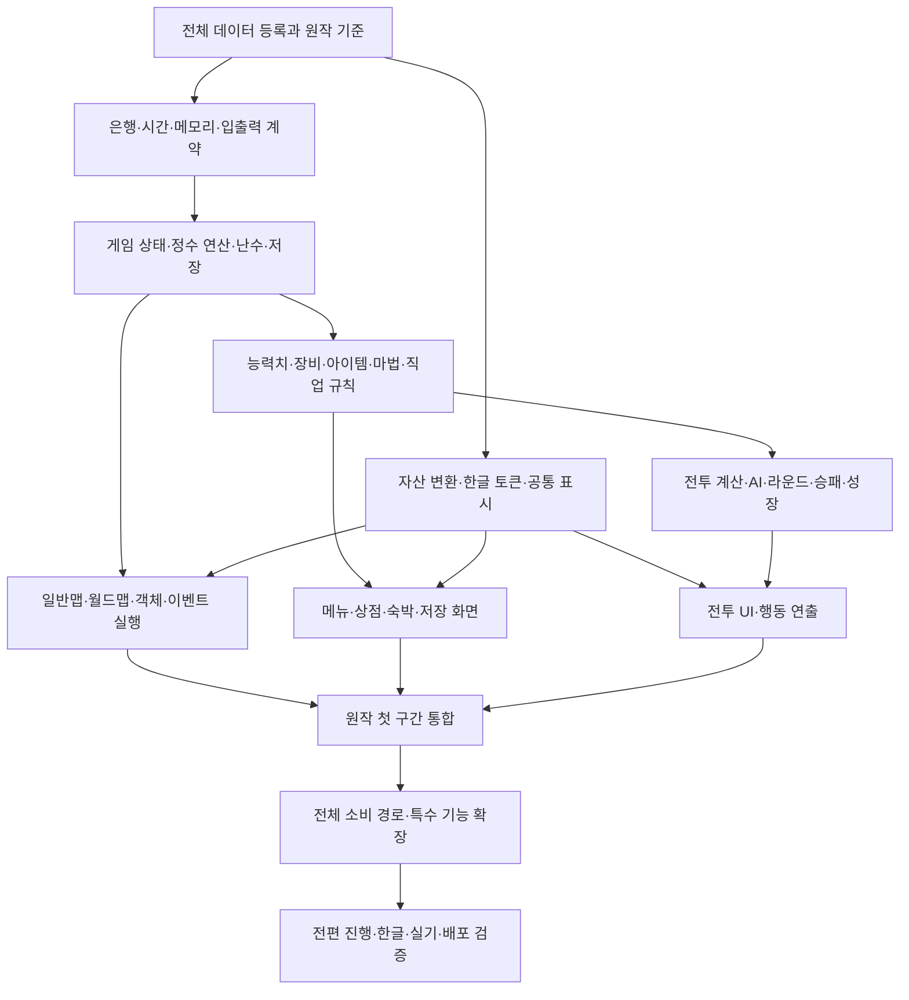

# FF3 한글 GBC 이식: 현재 구현 순서

2026-11-23 재검토. 이 문서가 앞으로의 우선순위 기준이다. [최초 계획](port-plan.md)의 원작 충실도·표현 승인·ROM 입력 배포 계약은 유지한다. 기존 시제품의 가상 게임 규칙은 채택하지 않는다.

같은 날 후속 등록 작업을 완료했다. [데이터 등록부와 참조 감사](data-registry.md)가 아래 최초 조사 수치/미해결 분석을 갱신한다. 166영역과 16바이트 미분류 구간으로 PRG 전체를 등록했으며, 트리거는 물리 256/선택 128/비null 96슬롯, AI는 64슬롯 보존이 맞다. FE/FF와 정상 진행 도달성은 계속 미해결이다. 은행·메모리·시간 기반의 첫 구현도 [후속 기록](platform-foundation.md)에 연결했다. 다음은 예약된 상태 영역에 원작 초기화·RNG·저장 의미를 구현하는 작업이다.

## 결정

**공통 데이터와 실행 기능을 의존 순서대로 이식하고, 기능이 생길 때마다 원작의 대표 구간을 연결한다. 모든 지역은 같은 실행기로 일괄 검사하며, 게임 진행 순서는 마지막 통합 검증의 축으로 사용한다.**

던전 하나의 타일과 이벤트를 맞춘 뒤 다음 던전으로 넘어가는 순서는 채택하지 않는다. 맵은 공통 포맷과 실행기를 공유하므로 지역별 수작업이 중복과 예외 코드를 만든다. 반대로 전체 맵·캐릭터·메뉴·전투를 서로 독립적으로 끝낸 뒤 한꺼번에 합치지도 않는다. 장비·직업·상태·아이템 소비·이벤트 플래그·저장 구조가 서로 연결돼 있어 통합을 늦추면 재작업이 커진다.

구현 단위는 **지역이나 개별 NPC가 아니라 데이터 포맷, 명령군, 상태 전이와 그 소비 코드**다. 콘텐츠 ID별 처리는 원작에 실제로 특수 분기가 있을 때만 추가하고 근거 주소를 남긴다. 세로로 연결한 대표 구간은 공통 시스템을 검증하는 수단이며 콘텐츠별 별도 구현물이 아니다.

## 현재 결과가 의미하는 범위

- 음악/효과음 동시 진행, 채널 점유/복원, 음표·반복·엔벌로프, 음악 요청·템포·페이드인/아웃의 원작 로직과 GBC 출력 경로를 구현했다. [사운드 검증](audio-native.md)의 검사 범위 안에서 통과했다. 모든 곡 전체 길이/모든 조합의 전수 청취 합격은 아니다.
- 제단 동굴 바위 이벤트는 원작 데이터로 화면/사운드를 같이 돌린 첫 부하 검사다. [통합 결과](field-audio.md)는 3,600틱, 장면 6회, 지연/큐 고갈 0이다. NPC와 플레이어가 없는 이 구간을 전체 게임 성능으로 계산하지 않는다.
- 기존 그림/한글 UI 실험은 표시 가능성의 근거다. 원작 메뉴·전투 실행기 완성으로 계산하지 않는다. 음색 조정은 사용자 결정대로 보류한다.
- 이전 답변의 “다음은 이동·NPC 연결”은 필요한 기능이지만, 그 앞에 **전체 데이터 등록·공통 상태·은행/메모리 설계**가 빠져 있었다. 이번 순서로 수정한다.

## 자료 전반을 점검한 결과

기준은 [everything8215/ff3 고정 리비전](https://github.com/everything8215/ff3/tree/1acef8117120ff891003de249b1a74bc8d94d674)의 ROM/RAM 지도, 주석 디스어셈블리, 이벤트/텍스트 자료와 로컬 FF6Tools 정의다. `tools/survey-source.mjs`는 자료 7개의 해시, ROM 지도 166영역, 디스어셈블리의 제목 1,623개, 편집기 최상위 정의 21개를 목록화했다. 제목 개수는 검증된 함수 수나 완성률이 아니다.

로컬 조사 결과 `build/analysis/source-survey.json`의 SHA-256은 `72ead67682ddebf16efe77924e06983af5c05b3407f1aca783fb0dba68b968e2`다. 두 번 실행한 보고서가 바이트 단위로 일치했다. 보고서에는 자료별 해시와 모든 항목/미해결 항목이 있으며 공개 목록에는 넣지 않는다.

전체 목록을 점검한 범위와 실제 의미/실행 검증을 구분한다. 모든 코드의 의미와 모든 스토리 도달성을 이번에 증명한 것은 아니다. 현재 의미 검증은 사운드, 첫 이벤트, 맵 압축 해제 및 아래에 명시한 소비 코드에 한정된다.

| 데이터/실행군 | 확인한 규모와 구조 | 구현 순서에 주는 의미 |
|---|---|---|
| 일반 맵 | 속성 512슬롯, 레이아웃 포인터 256슬롯, 7타일셋, 그래픽 조합 48슬롯 | 공통 로더/렌더러 구현 후 전 슬롯 검사. 512개 화면을 손으로 만들지 않음 |
| 일반 맵 레이아웃 | 256슬롯 전부 해제하여 원작 `3E/CBFA`와 일치; 서로 다른 해제 결과 220개. 맵 속성은 레이아웃 ID 234종 참조 | 중복 포인터/동일 레이아웃과 실제 맵 ID를 구분; 지형 모양 수는 지역/진행 수가 아님 |
| 월드맵 | 압축 행 포인터 1,024슬롯, 서로 다른 포인터 896개. 편집기는 5개 월드 상태를 노출 | 일반 32×32 맵과 다른 스트리밍 경로. 행 데이터 수를 독립 월드 개수로 세지 않음 |
| NPC | 배치 목록 포인터 256슬롯, NPC 조건/대사 스크립트 512슬롯 | 공통 객체 갱신·충돌·조건 선택기. NPC 512개를 별도 클래스로 만들지 않음 |
| 이벤트 | 포인터 256슬롯 중 254개 명령 경계 해석 성공, 사용 opcode 값 191종 | 객체 번호가 명령 상위 비트에 포함되므로 191개 독립 기능이라는 뜻은 아님. 명령군과 공유 처리기 단위로 이식 |
| 조건/특수 요청 | 트리거 포인터 영역 256슬롯, 아이템 선택 48슬롯, 동행 NPC 8, 조건부 BGM 8 | 대사만 구현해서는 NPC가 완성되지 않음. 조건·아이템·월드 상태가 먼저 필요 |
| 전투 구성 | 편성 512슬롯, 몬스터 256슬롯, AI 스크립트 자료는 49항목으로 표기 | 개별 전투를 수동 제작하지 않고 편성/AI 해석기를 사용. AI 유효 범위와 패딩은 소비자 감사 필요 |
| 행동/장비 | 무기 88, 방어구 64, 공격 속성 115슬롯 | 장비 계산과 아이템/마법 효과를 메뉴·필드·전투가 공유 |
| 전투 계산 분기 | `30/9E76` 알고리즘 포인터 10개; `31/BA9C` 효과 포인터 57개, 서로 다른 진입 주소 32개 | 공통 피해/회복/상태/대상 처리기를 먼저 검증. 주소 공유만으로 의미까지 같다고 단정하지 않음 |
| 직업/성장 | 직업 22, 레벨 경험치 경계 98, 직업별 성장 레코드 22×98 | 직업별 별도 게임 로직보다 원작 테이블과 계산기. 경험치 3바이트 폭 보존 |
| 그래픽/연출 | 일반 적 그래픽 영역, 보스 타일맵 24슬롯, 소환/무기/마법 프레임·스크립트, 22직업 그림 | 기본 자세만 보고 완료하지 않음. 대형 보스·상태 변화·마법은 별도 표현 소비 경로 |
| 텍스트 | 본문/메뉴 공용 포인터 1,712슬롯, 별도 컷신 17, 크레딧 31 | 본문에 한글이 나오더라도 이름·치환·메뉴·컷신·엔딩은 별도 확인 |
| 창 | 필드/메뉴 창 좌표/크기 표 38슬롯(`3D/AAF7..AB8E`), 전투 창은 별도 경로 | 원작 창 기능을 공통 UI 위에 올리되 NES 좌표를 GBC에 그대로 복사하지 않음 |
| 영속 상태 | 작업 상태 `$6000..63FF`, 원작 저장 슬롯 3×1,024바이트, 파티 4명×2블록, 가방 32칸/별도 보관함 | 새 게임/아이템/직업을 붙이기 전에 상태 폭·수명·저장 계약을 확정 |
| 난수 | 필드 `3E/C711`, 전투/컷신 `3F/FBEF`, 초기화 `3F/FC27` | 하나의 새 난수기로 통일하지 않음. 계산과 연출의 난수 소비도 따로 추적 |

슬롯은 저장 공간의 분모다. 중복·미사용·조건부 접근이 있으므로 실제 유효 콘텐츠 개수나 이식 완료율로 부르지 않는다. 49 AI 항목은 자료의 선언 값이며 나머지 표와 같은 수준의 전수 의미 검증을 주장하지 않는다.

### 자료의 불일치와 미해결 항목

- ROM 지도에서 NES 표기 주소와 파일 오프셋의 기계적 환산이 맞지 않는 영역 12개를 기록했다. 일부는 은행 구간 표기 관례이고 일부는 실제 오기다. 이를 모두 게임 데이터 오류로 취급하거나 자동 수정하지 않는다. 이전 6502 명령 바이트 감사와 별개의 검사다.
- FF6Tools는 `mapLayout`과 `npcProperties`에 각각 512항목을 선언하지만 해당 16비트 포인터 영역은 각각 256슬롯이다. 편집기 정의를 그대로 제품 추출 명세로 쓰지 않는다.
- `field-ram.txt`는 `$6020..602F`를 256개 이벤트 비트로 표기하지만 실제 범위는 128비트다. 원작 `3C/9344`도 ID를 `$7F`로 마스킹한다. 저장 구조는 주석의 숫자보다 소비 코드를 따른다.
- 이벤트 `$FE/$FF` 슬롯은 포인터가 `$C000`이다. 스크립트 은행 범위를 벗어나며 용도/도달성이 미확인이다. 이번 조사기는 두 항목을 명시적으로 남기고 **종료 코드 1**을 반환한다. 254/256을 256/256 합격으로 바꾸지 않는다. 다음 등록 작업에서 참조와 원작 주소 매핑을 확인한다.
- 이벤트 설명표의 E3–E6 “효과 없음”과 명령 길이는 별개다. 원작 `3E/D219`는 E4–FC를 2바이트로 소비하고 FE도 별도로 2바이트 처리한다. 설명표만 보고 1바이트로 읽으면 후속 명령이 어긋난다.

이 때문에 “자료가 있으니 전체 자동 변환만 하면 된다”는 계획은 성립하지 않는다. 자료는 조사 출발점이고, 제품에 들어갈 각 포맷은 ROM·참조·소비 코드를 연결한 등록이 필요하다.

## 의존 관계

이 그림은 모듈 의존 관계이며 에이전트 병렬 실행 지시가 아니다. 한 모듈 전체를 끝내야 다른 모듈을 볼 수 있다는 뜻도 아니다. 공통 상태가 준비되면 필드와 전투 계산은 독립적으로 검증할 수 있다. 각 PR은 작은 기능을 실제 데이터와 연결해 끝낸다.

## 단계별 구현과 완료 조건

| 순서 | 작업 | 다음 단계로 넘기는 기준 |
|---|---|---|
| 1. 등록과 가장 큰 위험 확인 | 이번 조사 목록을 제품용 데이터 등록부로 승격. 원본 주소/크기/소비자/변환/상태를 기록. 코드 뱅킹, 전투 최대 자산, 한글/스프라이트 동시 부하 확인 | 알려진 불일치에 해결 근거 또는 명시적 미해결 상태. 새 기능이 고정 은행·WRAM·VRAM·OAM을 넘기지 않을 설계와 측정 |
| 2. 공통 기반 | ROM 데이터 핸들·은행 호출, 논리 틱/표시 프레임 분리, 입력, GameState, 정수/비트 연산, 두 난수 경로, 새 게임 초기값, 저장 직렬화 | 원작 초기 상태/상태 폭과 대조, 저장 왕복·슬롯/체크섬 검증, 은행 전환 중 오디오 회귀 통과 |
| 3. 전체 자산 공급과 공통 표시 | 일반맵/월드행/객체/전투 자산/문자열 포인터를 포맷별 일괄 추출. 그림 ID·포즈·팔레트·VRAM 상주 규칙. 한글 토큰/이름/치환과 창/선택/스크롤 기본부 | 전 슬롯에 해석/변환/미해결 상태가 존재. 지형 7종·다양한 월드 상태·밀집 NPC·큰 보스·긴 한국어 문장의 대표 검증. 모든 그림을 미리 VRAM에 넣는 방식 금지 |
| 4. 공유 게임 규칙 | 능력치·장비 가능 여부/교환·가방·상태·아이템/마법·직업·성장·돈/CP. 원작 함수 경계별 C 구현 | 같은 상태와 난수 입력에서 값·소비량·실패 경로·부작용 일치. 필드/메뉴/전투가 각각 별도 포션·장비 규칙을 만들지 않음 |
| 5A. 탐색 실행기 | 일반/월드 이동·충돌·스크롤, 공통 객체와 플레이어/동행 NPC, 배치/조건/트리거 선택, 이벤트 대기/반복/대사/플래그/이동/음악/전투 요청 | 타일셋별 경계·맵 전환·조건 분기와 원작 이벤트 비교. 바위 이벤트는 직접 호출 대신 정상 조건에서 발생 |
| 5B. 메뉴와 전투 계산 | 원작 메뉴 상태/취소/대상 선택/상점/숙박/저장. 전투 초기화→명령 예약→행동 순서→AI/대상→효과→턴 종료→승패/보상/성장 | 실제 아이템 소비 시점, MP/장비/상태·RNG 소비 순서 일치. 메뉴와 계산이 같은 상태를 사용. 표/효과 핸들러별 호스트 검사를 먼저 수행 |
| 6. 전투 표시와 첫 정상 진행 | 승인 전투 배치에 원작 포즈·무기·적·마법·상태·커서·수치 연결. 새 게임/이름→초기 전투/동굴→보스→크리스털/직업 해금→저장 가능한 곳에서 저장·재개 | 개발용 직행·가상 보상 없이 실제 입력으로 흐름 연결. 필드↔전투 상태 전달 및 한글 UI/사운드 동시 부하 통과 |
| 7. 기능군별 전체 확장 | 남은 opcode/공유 소비자·특수 연출, 차량/잠수·월드 변화·미니/개구리·문/보관함·후반 보스·엔딩을 기능별로 완성 | 각 기능을 사용하는 모든 맵/이벤트를 역참조해 일괄 재검사. 특정 지역 수정으로 같은 기능의 다른 지역이 깨지지 않음 |
| 8. 전편/출시 검증 | 새 게임부터 엔딩까지 진행 순서 QA, 분기/전멸/취소/저장 재개, 한국어 최종 교정, 보류 음색 해결, 독립 에뮬레이터/실기, 오프라인 배포 | 필수 소비 경로 미구현 0, 진행 방해 결함 0, 공개 허용 입력만으로 재현 빌드. 원본/추출/번역 비공개 정책 유지 |

5A/5B는 같은 기반을 사용하는 두 작업 흐름이다. 모든 맵 이동이 끝날 때까지 전투를 미루지 않는다. 4부터 원작 전투 알고리즘을 호스트에서 검증하고, 3에서는 최악 자산의 화면 예산을 먼저 확인한다. 반대로 전투 UI만 먼저 완성해 가짜 계산기를 붙이지 않는다.

단계는 의존 순서이지 “3의 모든 미술 작업, 4의 모든 효과 구현이 끝나야 5를 시작한다”는 일괄 인계 규칙이 아니다. 전체 목록/공통 계약을 먼저 확보한 뒤, 필요한 소비자부터 묶어 연결한다. 예를 들어 원작의 실제 보물상자 데이터로 `조건 검사 → 아이템 획득/가방 가득 참 → 원작 메시지의 한글 표시 → 획득 플래그 → 저장·재로딩`을 검증하고, 같은 소비자를 사용하는 다른 상자를 일괄 검사한다. 다른 지역을 위해 별도 상자 로직을 만들지 않는다. 장비 교환도 공통 계산 한 묶음과 해당 메뉴를 연결해 검증하며 전체 마법 연출 완성을 기다리지 않는다.

한글도 끝에 몰아서 붙이지 않는다. 3에서 글자/토큰/동적 이름과 길이 계약을 정하고, 기능별 UI가 연결될 때 실제 한국어를 적용한다. 8은 누적 적용 결과의 전편 교정이다. 제공된 번역 자료는 계속 비공개 입력이며 보관 위치/매핑/검수 이력은 [번역 입력 기록](localization-inputs.md)을 따른다.

## 바로 다음 구현 묶음

다음 던전이나 이벤트 하나를 더 재현하기 전에 다음 세 PR 규모의 일을 우선한다.

1. **FF3 데이터 등록과 미해결 참조 정리 — 등록 작업 완료:** [등록부](data-registry.md)에 전체 영역, 알려진 정형 표/포인터 슬롯, 검증한 참조와 남은 소비 계약을 기록했다. 일반맵 256·월드행 1,024·AI 256·조건 상태 2,146·트리거 입력 256개를 원작과 대조했다. 모든 포맷 의미나 정상 진행 도달성이 완료된 것은 아니다.
2. **제품 은행·메모리·시간 기반 — 첫 구현 완료:** [은행 호출·범위 검사·고정 상태 예약·필드 작업 공간 분리](platform-foundation.md)를 사운드/화면 검사에 연결했다. 추가 WRAM 은행, 실제 전투 작업 공간 크기, 저장 포맷은 아직 완료되지 않았다. 원작 상태/저장 의미와 기능별 예산을 다음 소비자마다 검증한다.
3. **공통 상태와 원작 계산 기준:** 새 게임 초기값, 4인 상태, 24비트 경험치/돈, 가방·이벤트/NPC 플래그, RNG와 저장 왕복을 원작과 대조한다. 이를 통과한 뒤 일반맵 객체 이동과 장비/전투 계산을 연결한다.

첫 동굴은 다시 방문할 통합 테스트 경로다. 동굴 전용 코드를 계속 늘리는 것이 다음 목표는 아니다.

## 초기에 해결해야 재작업을 줄이는 문제

- **고정 은행:** 최초 통합 코드 끝은 `$393D`로 `$4000`까지 1,731바이트였다. 이후 [은행 기반](platform-foundation.md)에서 사운드 코드를 분리했다. 데이터 은행이 넉넉해도 코드가 자동으로 들어가지는 않는다. 원작처럼 시스템별 코드/작업 공간의 수명을 나눠야 한다. [GBDK 은행 문서](https://gbdk.org/docs/api/docs_rombanking_mbcs.html)
- **전체 RAM:** GBC의 큰 총 RAM 용량과 CPU에서 동시에 보이는 창은 다르다. 원작의 필드/전투 RAM 겹침을 통째로 중복 할당하지 않고, 상태 소유권/은행/스택 예산을 정한다. [Pan Docs 메모리 지도](https://github.com/gbdev/pandocs/blob/master/src/Memory_Map.md)
- **객체 표시:** OAM은 총 40개, 한 스캔라인 10개 제한이 있다. 아군 원본 크기 유지 조건에서 무기·효과·커서·NPC가 몰리는 구간을 먼저 측정한다. 정적인 적을 배경에 배치하는 등 표시 계층 설계와 원작 행동 의미를 분리한다. [Pan Docs OAM](https://github.com/gbdev/pandocs/blob/master/src/OAM.md)
- **특수 전투 표현:** 원작에는 석화 캐릭터의 배경 표시, 보스 변형과 MMC3 IRQ로 타일맵을 교차 표시하는 효과가 있다. 첫 동굴만 완료한 뒤 발견하면 렌더러를 다시 만들 수 있다. 실제 원작 자산/연출로 이 경로를 조기 조사하고 GBC 표현 예산을 확보한다.
- **난수와 시간:** 전투 진입 시 원작은 작업 메모리를 사용해 RNG를 초기화한다. GBC의 임의 RAM 합으로 대체하지 않는다. 비교용 가상 원작 상태와 실제 제품의 초기화 계약, 논리 틱·입력 샘플링·연출 RNG 소비를 함께 설계한다. 화면 프레임 일치만으로 결과 동등성을 주장하지 않는다.
- **저장과 이름:** 원작 3슬롯 의미를 유지하되 한글 사용자 이름의 인코딩/길이와 배터리 저장 형식을 초기에 정한다. 현재 ROM-only 진단 헤더는 최종 제품 저장 구성으로 재사용하지 않는다.

## 각 기능의 검증 방식과 진행률

등록부에서 `위치 확인 → 경계/참조 확인 → 의미 확인 → 추출/변환 → C 실행 대조 → GBC 동작/부하 → 정상 진행`을 따로 기록한다. 추출 완료를 이식 완료로 세지 않는다. 미구현 명령을 만나면 오류를 보여주며 성공 처리하지 않는다.

반복 검증의 범위는 변경이 영향을 주는 소비자와 모든 참조 항목이다. 계산은 호스트에서 넓게, GBC에서는 ABI/은행/메모리/시간과 대표 동작을 확인한다. 게임 진행 순서로는 장기 상태 누적·분기·저장 재개·엔딩을 검증한다. 서로 대체할 수 없는 검사다.

기준 데이터·추출물·원시 관측은 로컬에 두고 출처·명세·검사 도구·요약 결과만 공개한다. `tools/survey-source.mjs --references PATH`는 개발 분석 도구이며 제품 빌더 의존성이 아니다. 현재의 종료 코드 1은 위 FE/FF 두 슬롯 미해결을 의미한다. 이 조사 작업에서는 게임 실행 코드를 변경하지 않았다.

## PR 운영

사용자 지시에 따라 작업 브랜치 → PR → 정확한 PR head의 변경/검증 확인 → 보호 규칙을 지키는 병합 순서로 진행한다. `main` 직접 push와 강제 push를 사용하지 않는다. 이번 계획과 이전 통합 변경도 현재 `ff3-gbc-audio`에서 PR로 전달한다. 스킬 출처와 설치/적용 범위는 [개발 스킬 기록](development-skills.md)에 있다.
