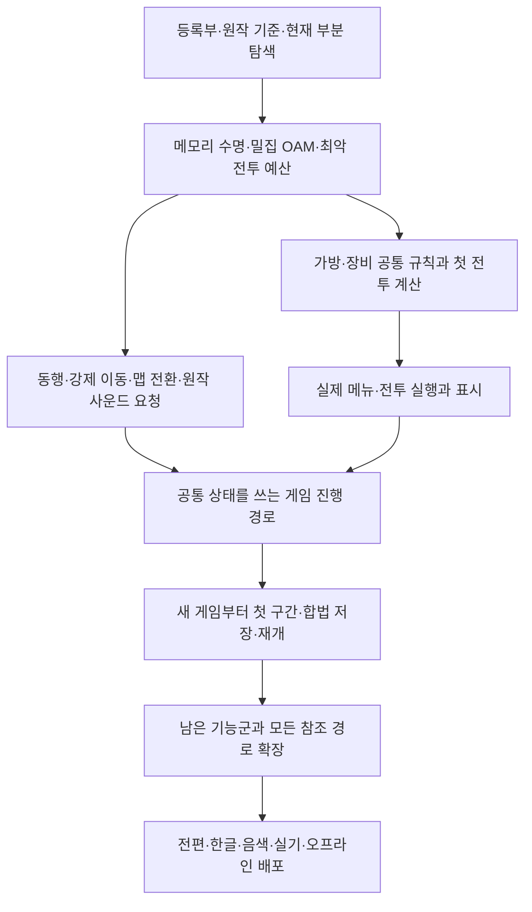

# FF3 한글 GBC 이식: 현재 구현 순서

2026-11-28, PR 15 회고와 R2 전투 전체 표시 계약·영상 관찰·이벤트 전투 등록 반영. **앞으로의 우선순위는 이 문서 한 곳에서 관리한다.**
각 기능 문서의 수치와 “다음 작업”은 해당 PR 당시 기록이다. [회고](retrospective-pr15.md)는
PR 15 기준선을 보존하고 [전체 진척](progress.md)은 후속 결과를 갱신한다. [이전 로드맵 원문](https://github.com/hungrysanta-ksc/game-patch-gbc/blob/aeeedf69c071a597c06237c0e6ebcb0ce6440264/games/final-fantasy-3-gbc/docs/implementation-roadmap.md)은 Git 이력에 보존한다.

## 유지하는 방향과 바꾸는 순서

**공통 데이터·규칙·실행기를 의존 순서대로 옮기고, 기능마다 원작의 대표 경로를 연결한다.**
던전별 수작업이나 모든 시스템을 독립 완성한 뒤 마지막에 합치는 방식은 채택하지 않는다.
원작 ROM과 소비 코드가 기준이며, 미지원 기능은 성공한 것처럼 넘기지 않는다.
원작에 없는 포션·보상·메시지·전투 규칙을 진척 확보용으로 만들지 않는다.

PR 4 이후 탐색·대사의 실제 연결은 유효했지만, 초기 계획의 전투 자산 예산과 밀집 객체,
공유 규칙 검증이 늦어졌다. **다음 구현은 동행 NPC 추가가 아니라 메모리 수명·표시 예산의
위험 해소부터 시작한다. 전투 계산도 전체 탐색 완성을 기다리지 않는다.**
성능 최적화는 재현된 정체와 기준 위반을 해결할 때 수행하고, 모든 경로의 60fps 달성을
공통 규칙 구현의 선행 조건으로 삼지 않는다. 원작 논리 속도·판정과 오디오 연속성은 유지한다.

[최초 범위](port-plan.md)와 [제품 정책](../spec/port-policy.json)은 유지한다.
아군 그림은 축소하지 않고, 적은 승인한 중간 축소안, UI는 7×7 한글을 사용한다.
[음질 개선](audio-backlog.md)은 후순위로 두되 출시 전 검증에 포함한다. 11월 23일 재확인한 노이즈
피드백에 따라 음색 조정뿐 아니라 채널별 원인 분석·다른 변환/재생 방식 비교도 포함한다.
현 이식 순서를 중단하지 않으며 타이밍 검증을 청취 승인으로 간주하지 않는다. 최종 제품은 원본 ROM의 데이터를 추출·변환하고
원작에 대응하는 GBC 코드를 컴파일·링크하는 오프라인 패키지다. 범용 6502 자동 번역기를 약속하지 않는다.

## 의존 관계

이는 모듈 의존 관계다. 에이전트 병렬 실행 지시가 아니다. 아래 작업 묶음은 계획 ID이며
GitHub PR 번호가 아니다. 크기가 커지면 검증 가능한 함수/소비자 경계로 나눈다.

## 바로 다음 작업 묶음

### 최우선: 필드→전투→필드 통합 관문 (2026-11-27 재점검)

[원작/현행 자원 수명 감사](field-battle-lifecycle-review.md)에 따라 아래 독립 전투
최적화의 후속 순서를 대체한다. 최근 713ms는 마법 준비이며 필드 돌입 시간이 아니다.
최초 재점검에서는 별도 main, WRAM 예약 충돌과 진단 파티 공급이 확인됐다.
공통 링크와 아래의 같은 부팅 왕복으로 표시·메모리 인계를 연결했으며, 자연 조우는
실제 맵 181의 선택 편성·현재 파티 표시와 진단 복귀까지 연결했다. 정상 행동 계산과 전투 결과 경로는 미통합이다.

1. 원작 진입/복귀 소비자와 지속 상태·장면 문맥을 대조하고 전 모드 메모리/큐/캐시
   수명 등록부를 통합한다. 고정 RAM·스택 여유도 같은 링크 결과로 검증한다.
2. 단일 부팅/오디오 엔진/표시 디스패치 아래 실제 필드 조우→전투 적재→필드 재구성의
   왕복 경계를 연결한다. 진단 중단은 승리/보상으로 세지 않는다.
3. 현재 파티·가방과 원작 선택/계산/행동/도주·승패·이벤트 복귀를 연결한다.
   같은 부팅의 두 번째 전투와 복귀 후 이동/NPC 대화까지 확인한다.
4. 진입/첫 표시/입력 가능/첫 행동/종료/필드 입력 재개를 나눠 측정하고 실제 병목을
   최적화한다. 필드 표시·오디오를 깨뜨리는 선행 로딩/캐시는 채택하지 않는다.

원작 상태·V6·도트·숫자·음악/효과음은 유지하며 기존 독립 검증은 회귀로 쓴다.
자원 인계 오류 수정은 즉시 하되, 마법 단독 몇 ms 절감을 통합보다 먼저 반복하지 않는다.
월드/차량·연속 이벤트 전투·소환/특수 소비자는 같은 계약으로 확장한다.
[자원 등록부·원작 경계 실행 검사](scene-resource-contract.md)를 추가했다. 기존 저장
범위 19개와 소유권 10개, 관련 소스 52개를 등록하고 원작 문맥/가방 소비자의
512개 경계 사이클을 검사했다. 오래된 WRAM 3 필드 예약은 제거했지만 새 보존 영역을
할당하지 않았다. 후속 [표시 소유권 경계](scene-video-handoff.md)는 공통 attach/detach와
실제 필드/전투 표시기의 개별 재진입을 검증했다. 합친 실제 링크에서는 고정 RAM/ROM
초과와 자산 뱅크 충돌이 확인됐다. 후속 [공통 링크 배치](scene-link-layout.md)는
지속 상태와 장면 DATA를 분리하고 WRAM7에 필드 문맥/작업 공간을 보존하며, 비 IRQ
초기화·기존 main·자산의 공통 뱅크 배치를 적용했다. 실제 필드와 전투는 같은 바이너리의
별도 부팅으로 검사하며, 아직 main끼리의 자연스러운 왕복은 아니다.
후속 [같은 부팅 왕복](scene-roundtrip.md)은 공통 GameState·오디오 아래에서 실제 필드와
전투 표시기를 연결했다. 원작처럼 NPC 초기화를 건너뛰고 그래픽만 복구하며, 두 번의
진입과 복귀 후 버튼 이동·한글 대화를 검사한다. 진단 요청에 의한 표시 왕복의 완료이며,
정상 조우/승패 처리가 완료된 것은 아니다.

[일반맵 조우 선택](field-encounters.md)은 독립 난수·편성/배경 표와 이동 완료 후 요청을
연결했다. 통제된 타일/확률의 버튼 검사는 자연 조우 진행으로 세지 않는다.

후속 [정본 파티 진입](live-party-entry.md)은 현재 캐릭터·장비에서 원작 전투 레코드,
직업/전열/상태 그림과 HP 창을 준비한다. mode 5의 명시적 표시 진입이며 적은 기존 진단
편성이다. 현재 파티용 행동 자원, 석화, 필드의 직업/상태 그림 갱신은 남는다.
독 상태 복귀 후 이동은 기존 미지원 필드 피해 경계를 확인했다.

**이름 정책 확정:** 사용자가 제공한 한글 NES판의 새 게임 시작을 직접 확인했다.
루네스·아르크·레피아·잉구스를 고정으로 사용하며, 이름 입력 기능과 일본어 이름
바이트 변환은 구현 대상에서 제외한다. 현재 시안의 네 이름은 그대로 유지한다.
한글 NES판은 비공개 동작 참고 자료이며, 배포 패키지의 입력 ROM은 기존 일본 원판이다.

후속 [선택 편성 자원 연결](encounter-resources.md)은 현재 맵의 원작 조우 그룹 전체를
등록하고, 선택된 편성·적 수·방향에 따라 14가지 공간 자원을 사용한다. 현재 직업과
양손 장비에서 공격 자원을 읽는다. mode 6 검사는 조우 가능 타일·확률과 FC27 초기값을
명시적으로 공급하며, 공격 계산과 승패 결과는 아직 연결하지 않았다.

후속 [원작 조우 시드 경계](encounter-seed-boundary.md)는 원본 새 게임에서 실제 첫 조우를
관찰하고, 진입 시 덮어쓰는 27바이트와 이어받는 229바이트를 확인했다. 전체 원작 입력을
받는 계산 소비자는 구현했으며, GBC 필드·오디오에서 그 입력을 공급하는 계약은 남는다.
고정 이름 정책도 반영했다. 자연 경로의 다음 대상은 실제 맵 181·배경 8이다.

후속 [GBC 플레이 상태 시드](play-seed.md)에서 사용자 승인에 따라 최초 난수 입력을
현재 GBC 필드·음악 상태로 정했다. 기존 난수 표·소비 순서·조우 확률은 유지하며,
NES와 같은 버튼 입력에 대한 결과 순서 일치는 요구하지 않는다. mode 6은 진입 경계에서
한 번 생성하고 복귀 시 재무장한다. 외부 시드 주입은 특정 경계값 검사용으로만 남는다.
원작 임시 메모리를 재현하기 위한 256바이트 그림자는 만들지 않는다.

후속 [첫 던전 조우·복귀](first-dungeon-encounters.md)는 원작에서 도달한 (3,19)를 개발 시작점으로 사용한다.
타일/조우율/난수를 주입하지 않은 이동에서 실제 편성과 동굴 배경을 표시하고 같은 부팅으로 3회 복귀한다.
오프닝 실행과 정상 승패/보상은 이 진단 범위에 포함하지 않는다.

**다음 순서:** 다른 조우
그룹을 위한 공유 패턴/지도 자원 등록 및 남은 행동 자원 → 행동 계산·승패/도주 결과
반영 → 정상 승패를 통한 동일 부팅 재조우 검증.
필드의 상태 피해/그림 갱신도 같은 왕복 검사에 포함한다. 진입 약 1초는 0.5초 목표에
미달하므로 공유 경로에서 준비 비용을 나누어 측정한다. 독립 마법 미세 최적화로 돌아가지 않는다.
석화·보스·아이템 등 남은 변형도 같은 자원 계약에 대조한다.
R2 0/8·제품 0/3은 그대로다.
아래의 “다음” 문단은 이전 단계 기록이며 이 최우선 순서를 대체하지 않는다.

### 2026-11-27 행 합성과 지도 셀 배치

[반복 연산 개선](battle-freeze-row-kernel.md)으로 기본 첫 시전은 1.826→1.792초,
재시전은 1.390→1.357초다. 최초 합성 291→282ms, 지도 준비 226→206ms이며
원본 인덱스·상주 수명·원작 대기와 실제 전송 바이트를 유지한다. 첫 복구 꼬리는
240→257ms로 늘었고, 입력 위상 하나의 재시전은 약 8ms 증가했다.

다음은 **남은 최초 합성의 타일 조회/변환과 지도·복구의 오디오/전송 위상**이다.
현재 표시/다음 준비의 소유권과 자원 수명을 유지하고, 동일 작업의 실제 CPU와
대기를 따로 측정한다. 특정 위상에 맞춰 원작 대기나 오디오 선행량을 줄이지 않는다.
첫 준비 0.5초, 소환/특수 경로와 정상 전투 통합은 남는다. R2 0/8·제품 0/3은
그대로이며 아래는 이전 단계 기록이다.

### 2026-11-27 재시전 회귀와 상주 준비 전송

[재시전 후속](battle-freeze-recast-preparation.md)으로 기본 조건 재시전은
1.407→1.390초다. 원작의 준비/소비 수명을 따라 정확한 의존성 읽기를 묶고,
미러·합성 타일·팔레트를 준비된 순서로 전송한다. 초기 자원 준비 146→130ms,
세 입력 시점의 실제 재시전은 17~38ms 단축됐다. 최초는 0~17ms 단축됐지만
기본 조건 첫 시전은 1.826초로 같고 지도 준비는 211→226ms로 늘었다.

다음은 **최초 합성의 실제 계산과 지도 준비의 오디오/VRAM 접근 위상**이다.
CPU 절감이 다음 대기에서 사라지는 경계를 우선 추적한다. 준비된 자원의 수명과
실제 전송/게시 가능 시점을 함께 검토하고 특정 노래 위상에 맞춰 원작 대기를
줄이지 않는다. 최초 합성 291ms, 초기 0.5초, 소환/특수 경로와 정상 전투 통합은
남는다. R2 0/8·제품 0/3을 유지하며 아래는 이전 단계 기록이다.

### 2026-11-27 합성·지도 처리와 전송 대기 분리

[처리/대기 분리와 상주 백업 전송](battle-freeze-transfer-costs.md)으로 첫 합성
314→291ms, 첫 지도 준비 226→211ms, 첫 복구 256→240ms, 첫 시전
1.909→1.826초다. 재시전 복구는 218→184ms이나 전체는 1.390→1.407초로
늘었다. 개별 CPU 절감과 전체 시전 속도를 구분하며, 두 시전 합계는 67ms 감소했다.

다음은 **재시전 지도 준비 164→177ms의 위상별 회귀와 최초 합성의 남은
실제 작업 비용**이다. 동일한 원작 작업에서 오디오 큐 시작 위상을 바꿔 비교하고,
준비 완료 후 추가 자원 검색이나 전송 목록 생성이 반복되지 않는지 확인한다.
최초 291ms 합성과 211ms 지도 준비, 소환/특수 경로, 정상 전투 통합은 아직
남아 있다. R2 0/8·제품 0/3을 유지하며 아래 문단은 이전 단계 기록이다.

### 2026-11-27 원작 인덱스와 행 단위 합성

[최초 합성 후속](battle-freeze-native-planes.md)은 RGB 확장을 늦추고 원본
비트플레인을 행 단위로 처리한다. 첫 합성 400ms→314ms, 첫 시전
1.960초→1.909초, 재시전 1.424초→1.390초다. 지도 준비는 첫 228ms→226ms,
재시전 177ms→164ms이며 현재 지도 백업과 원작 대기·오디오를 유지한다.

다음은 **약 314ms의 첫 합성과 226ms의 지도 준비 안에서 실제 작업과 전송
대기를 나누는 것**이다. 원작의 상주 그래픽/갱신 소유권을 유지하며, 화면에
노출되지 않은 준비를 안전하게 겹칠 수 있는지 전체 비용으로 비교한다.
전체 지도 작업 공간으로 바꾸는 안은 오히려 느려 제외했다. 0.5초 기준과
소환/특수 경로·정상 전투 통합은 미완료이며 R2 0/8·제품 0/3을 유지한다.
아래는 앞선 단계 기록이다.

### 2026-11-27 최초 합성과 지도/패턴 게시 묶음

[첫 준비 비용 개선](battle-freeze-first-preparation.md)으로 혼합 셀의 색은 실제
사용된 값별로 한 번 대응시키고, 지도와 합성 패턴 전송 요청을 256바이트로
묶었다. 하드웨어 DMA는 기존 128바이트와 VBlank 검사를 유지한다. 대표 첫 시전
2.093초→1.960초, 재시전 1.541초→1.424초, 재시전 마지막 게시 후 복구 285ms→218ms다.
지난 기록 비용 때문에 늘었던 첫 시전도 PR 96의 2.026초보다 줄었다.

**다음은 남은 최초 혼합 셀 약 400ms와 지도 준비 약 228ms의 자원 소유권**이다.
원작 타일/팔레트 인덱스 갱신과 비교해 변경 범위나 중간 복사를 줄일 수 있는지
검토하되, 현 상태 백업·실제 색·도트·숫자·오디오 큐 정책은 보존한다. 첫 최대
간격 약 1.021초·재시전 약 519ms는 여전히 0.5초를 넘는다. 소환/특수 경로와
아군 시전/발사·적 대상·반사·정상 계산/메뉴 통합 순서는 유지한다. R2 0/8·
제품 0/3이다. 아래는 앞선 단계 기록이다.

### 2026-11-27 초기 동결 합성과 패턴 사본 재사용

[동결 자원 재사용](battle-freeze-reuse.md)은 같은 장면의 실제 OAM·팔레트·셀·타일을
비교하고 마지막 합성과 BG 패턴 사본을 유지한다. 재시전 전체 1.859초→1.541초,
최대 게시 간격 921ms→586ms다. 첫 시전은 캐시 기록 때문에 2.026초→2.093초로
늘었다. 첫 시전과 반복 이득을 구분하며 도트·숫자·원작 대기·소리 요청은 유지한다.
복구 백업은 현재 상태에서 매번 보존하고 장면/참조 자원 변경 때 재합성한다.

**다음은 최초 합성과 지도 준비/복구의 남은 비용**이다. 재사용 성공 시에도 지도
준비 약 213ms, 패턴·팔레트 게시 약 100ms, 마지막 게시 후 복구 약 285ms가
남는다. 원작의 갱신 소유자와 비교해 변경된 자원만 준비하는 방법을 검토하되,
실제 두 지도와 UI 변경을 이전 상태로 되돌리지 않아야 한다. 초기 0.5초와
원작 속도는 아직 미달이다. 소환은 별도 호출/자원 경로이므로 이 수치를 적용하지
않는다. 아군 시전/발사·적 대상·반사·특수/소환·정상 계산/메뉴 통합 순서는 유지한다.
R2 0/8·제품 0/3이다. 아래는 앞선 단계 기록이다.

### 2026-11-27 고정 격자 주사선 검사와 오디오 비용 분리

[주사선 점유 재사용](battle-magic-scanlines.md)으로 고정 잔류 OBJ를 행동당 한 번
세고, 그림마다 원작 격자에서 나온 세 행의 객체 수를 검사한다. 원작 도트·숫자·
대기·오디오 큐 목표량은 유지한다. 전체 대상 첫 검사 45.609ms 중 일반 CPU는
13.959ms, 오디오는 27.339ms였고 각각 1.338ms·0.191ms로 줄었다. 행동 전체의
오디오 시간은 거의 같으므로 보충 위치 변화와 계산 감소를 구분한다. 실제 대상
전환 84/67/67ms→약 33.5/33.5/33.5ms, 전체 4.036초→3.852초다.

**다음은 초기 동결·복구의 호출자와 전투 상주 자원 수명을 다시 검토**한다.
잔류 표의 일회 준비로 초기 간격은 약 한 프레임 증가했다. 아군 자세·상태·팔레트가
변하지 않을 때 합성 결과를 다시 만들 필요가 있는지, 변할 때 무엇을 무효화해야
하는지 원작의 자원 갱신 경계와 비교한다. 원래 비활성 지도까지 복원하는 계약과
오디오 소비 간격은 유지하고, 반복 행동의 전체 시간·메모리 비용을 함께 검증한다.
초기 0.5초와 원작 전체 속도는 아직 미달이며 정상 진행 완료로 세지 않는다. 이후
아군 시전/발사·적 대상·반사·특수/소환·정상 계산/메뉴 통합 순서는 유지한다.
R2 0/8·제품 0/3이다. 아래는 앞선 단계 기록이다.

### 2026-11-27 대상 경계와 복구 중복 제거

[일반 마법 경계 비용](battle-magic-boundaries.md)을 원작의 한 번 적재·대상별 커서
초기화와 비교했다. 잔류 타일을 모아 전송하고, 첫 행의 좌표를 재사용하며,
이미 빈 최종 화면은 원작 대기만 다시 게시한다. 지도·잔류 타일 복구도 묶었다.
대표 행동은 2.228초→2.093초, 첫 그림 DMA 간격 67ms→50ms, 마지막 게시 이후
복구 301ms→283ms다. 전체 대상은 4.170초→4.036초지만 대상 전환 최대 약 84ms는
사실상 같다. 초기 포함 최대 간격도 1.038~1.055초여서 초기 0.5초 기준에 못 미친다.

**다음은 대상 첫 그림/전환의 주사선 검사와 오디오 보충 비용을 분리해 측정**한다.
현재 전체 대상에서 해당 동기 구간이 최대 45.609ms다. 원작의 고정 격자·행별
객체 구조로 같은 한도 판정을 더 적은 작업으로 할 수 있는지 비교하고, 실제
DMA 간격·전체 시간·오디오 부족을 함께 검증한다. 초기 동결/복구는 호출자의
전투 상주 자원 수명을 재검토해 다음 행동에서도 재사용 가능한 부분을 구분한다.
원작 대기·소리·도트·숫자나 접근 한도 검증을 생략하지 않는다. 이후 아군 시전/
발사·적 대상·반사·특수/소환과 정상 계산·메뉴 통합 순서는 유지한다. R2 0/8·
제품 0/3은 그대로다. 아래는 앞선 단계 기록이다.

### 2026-11-27 원작 유지 대기와 다음 마법 그림 준비

[다음 그림 준비](battle-magic-next-picture.md)를 현재 그림의 남은 세 대기와
겹쳤다. 현재 원작 OAM·활성 shadow는 유지하고 다음 원작 상태와 비활성 shadow를
따로 준비한다. 원작 `B7A9` 네 번 대기 뒤 확정하며 `B6F3` 소리를 미리 요청하거나
다음 대상으로 넘어가지 않는다. 같은 마법 전체 2.579초→2.228초, 초기 이후
최장 간격 100ms→67ms다. 초기 최대 간격 약 1.14초는 여전히 길다.
아군 4명 대상 전체는 5.695초→4.170초이나 연출 최대 간격 83.726ms가 남고,
최대 30쌍 마법의 초기 간격은 1.155초다. 대표 사례의 67ms를 전역 상한으로 쓰지 않는다.

**다음은 대상 첫 그림·대상 전환·복구의 남은 동기 비용을 원작 소유권과 비교**한다.
대기 수를 줄이거나 소리 요청을 앞당겨 맞추지 않는다. 선행 준비는 같은 대상의
그림/끝의 빈 그림까지만 허용하며, 새 소비자에 확대할 때 시전 조건·좌표·자원
수명을 다시 검증한다. 이후 아군 시전/발사·적 대상·반사·특수/소환과 정상 계산·
메뉴 통합 순서를 유지한다. 정상 진행 완료 수치는 올리지 않으며 R2 0/8·제품 0/3이다.
아래는 앞선 단계 기록이다.

### 2026-11-27 현재 타일 재사용·아군 행 합성

[합성 중 타일 재사용](battle-freeze-cell-cache.md)으로 같은 일반 마법의 합성 구간은
442ms→370ms, 초기 최대 간격은 1.222초→1.155초, 전체는 2.613초→2.579초다.
임시 캐시는 실제 VRAM만 읽고 매번 무효화하며 기존 전송 scratch 안에서 끝난다.
원작 대기·소리 요청·도트·숫자와 동적 그림은 유지한다.

**다음은 약 100ms로 남은 연출 간격과 다음 그림 준비의 소유권 분리**다.
현재 `animation_source`는 화면 검증에도 쓰이는 현재 원작 프레임이므로 유지 도중
다음 그림으로 덮어쓰지 않는다. 다음 페이지와 다음 원작 상태를 별도로 준비할 때
`33/B6F3` 소리 요청과 `B7A9` 네 번 대기의 경계를 보존하고 전체 비용으로 판단한다.
초기 준비는 아직 1초 이상이며 정상 사용 경로 승격은 보류한다. 개선 수치로 정상
전투 완료를 대신하지 않고, 그 뒤 아군 시전/발사·적 대상·반사·특수/소환과 정상
계산·메뉴 통합 순서를 유지한다. R2 0/8·제품 0/3은 그대로다. 아래는 앞선 기록이다.

### 2026-11-27 배경 정본 재사용·지도 보존 구간

[배경 자원 보존 개선](battle-freeze-resources.md)으로 동일 마법의 초기 최대
간격을 1.440초→1.222초, 전체 행동을 2.797초→2.613초로 줄였다.
불변 배경 패턴은 ROM 정본에서 직접 공급하고, 실제로 서로 다른 지도는 바뀐
범위를 묶어서 보존/복구한다. 전송량만 최소화한 느린 후보는 채택하지 않았다.

**다음은 아군 셀 합성의 반복 읽기/변환과 유지 프레임 중 다음 그림 준비 분산**이다.
셀 합성은 아직 약 442ms이며, 초기 이후 최대 게시 간격은 84ms→100ms로 늘었다.
새 정렬에서 오디오 생산이 집중되는 프레임도 함께 측정한다. 원작 4대기와 소리 요청
시점·도트·숫자를 바꾸지 않는다. 현재 패턴 정본 규칙은 변형 없는 일반 전투 범위다.
돌/보스·사망 등의 가변 자원 통합 전에 쓰기 소유권을 확장해야 한다.
이후 아군 시전/발사·적 대상·반사·특수/소환, 정상 계산·메뉴 통합 순서를 유지한다.
R2 0/8·제품 0/3은 그대로이며 아래는 앞선 단계 기록이다.

### 2026-11-27 일반 마법 자원 상주와 준비 비용

[상주 타일쌍과 공유 동결 개선](battle-magic-residency.md)으로 PR 90의 같은
35게시 행동을 5.544초→2.797초로 줄였다. 원작 B589의 한 번 적재와 B711의
상주 타일 선택을 따르며 그림·대상별 효과 풀 재전송을 없앴다. 숫자·도트·
원작 대기 수·오디오를 유지한다. 초기 이후 최대 게시 간격은 368ms→84ms다.

**다음은 아직 약 1.44초 걸리는 최초 동결·페이지 준비의 자원 수명 개선**이다.
원작의 정본 패턴/지도를 참고하여 VRAM 재읽기와 양쪽 지도 백업을 반복할 필요가
있는지 확인한다. 최소 영역 동결과 정본 자료의 재사용을 총 CPU·전송·메모리
비용으로 비교한다. 추정 초기값으로 복구하거나 화면을 생략하지 않는다.
이후 아군 시전·발사 → 적 대상 좌표 → 반사 → 특수/소환 공유 본체로 진행한다.
정상 계산·상태 확정/사망·메뉴 통합은 계속 남으며 R2 0/8·제품 0/3은 유지한다.
아래 항목은 이전 단계 기록이다.

### 2026-11-27 일반 마법 명중의 V6 연결

[일반 마법 실제 표시](battle-magic-video.md)는 원작의 적 시전자→아군 대상 경로를
먼저 연결한다. 이 경로는 원작에서도 아군 시전 자세·발사를 생략한다. 대상별 순차
실행, 한 그림 4게시, 대상/본체 종료와 효과음 요청을 유지한다. 최대 36개 효과 셀을
8×16 쌍으로 바꾸고 고정 아군 자세의 제한된 BG 동결을 재사용하여 도트를 보존한다.
OAM 전역 크기·패턴·팔레트와 원래 화면의 복구가 같은 소비자의 책임이다.

**다음은 새 일반 마법 경로의 자원 준비 지연 해소**다. 자동 재생 35게시의 전체
행동은 5.544초, 최대 게시 간격은 2.779초다. 원작 속도 또는 정상 사용 경로로
승인하지 않는다. signed BG 동결/VRAM 백업과 타일쌍 준비를 원작 07/08의
로드→상주→프레임 선택→복구 수명과 비교하고, 원본 패턴의 정본 보관·타일쌍 재사용·
최소 영역 동결을 전체 비용으로 비교한다. 명중 대상이 없는 경로의 불필요한 대여도
제거 후보이며 원작 대기와 소리 정지는 보존한다. 도트/숫자/오디오 한도는 완화하지 않는다.
그 뒤 **아군 시전·발사 → 적 대상 좌표 → 반사 → 특수/소환 공유 본체**로 진행한다.
아군 전체 대상은 현재 적 시전의 원작 순차 경로에서 검증하며, 이를 모든 전체 대상
기술의 완료로 세지 않는다. 실제 재생 비용은 도트/대기 수/오디오 검증과 별도로 기록하고
상주 타일쌍 재사용과 불필요한 자원 대여를 먼저 검토한다. 반복 계산이나 전송 때문에
원작 구조를 잃지 않도록 원작의 로드/유지/복구 경계와 비교한다.
정상 계산·상태 확정/사망·메뉴 통합은 계속 남으며 R2 0/8·제품 0/3은 유지한다.
아래 항목은 이전 단계 기록이다.

### 2026-11-27 공통 마법 프레임·진행 커서

[공통 마법 프레임](battle-magic-frames.md)의 128그림 압축 해제·대상 좌표·반전·
일시적인 OAM 교환과 88시퀀스 진행 커서를 원작 코드와 대조했다. GBC 함수 대조
6,676건이 통과했으며, 실제 V6 마법·소환 화면 연결 완료를 뜻하지 않는다.
25그림은 효과만 16 OBJ를 넘고 최대 36이라 아군 24 OBJ와 그대로 공존할 수 없다.
이 수치는 비어 있지 않은 타일 슬롯 수이며 픽셀 점유나 줄당 공존 검증은 아니다.

**다음은 공통 보통 마법의 시전·발사·명중 자원 수명과 V6 실제 화면 연결**이다.
원작의 대상별 순차 실행과 4대기·종료 1대기를 보존하고, 적 28×28 중심·백어택·
아군 상태·창·숫자·오디오를 함께 검사한다. 국소 효과 합성과 8×16 후보를 전체 비용과
복구 수명으로 비교하며, 프레임 전체 합성이나 도트 생략으로 한도를 피하지 않는다.
이어 전체 대상·반사, 특수 마법/소환의 공유 기능군을 연결한다. 19/24 포인터 슬롯
등록을 본체 구현으로 세지 않는다. 상태 확정/사망 → 정상 선택·계산·창 통합 순서를
유지한다. 아래 과거 다음 항목보다 이 단락이 우선이며 R2 0/8·제품 0/3은 그대로다.

### 2026-11-27 적 점멸·아군 피격·감싸기의 실제 화면 연결

[적 점멸·피격·감싸기](battle-hit-flash.md)는 원작 B024의 8회 속성 교환,
B201/A8B8의 직업별 그림·20회 피격과 정상 감싸기의 전후 4회 갱신을 연결한다.
원작 좌표/자세/효과음·그림 수명을 유지하고, GBC 화면 가장자리에서는 전체 그림을
고정 이동해 도트와 1px 흔들림을 보존한다. 점멸 지도는 한 번 준비하고 페이지를 교환한다.
혼란·석화·사망 피격과 상태 혼합 감싸기, 복수 점멸 마스크는 별도 미지원 경계다.
정상 메뉴·계산·상태 확정 통합의 완료로 세지 않는다.

최종 ROM에서 2,078개 화면(새 피격/점멸 1,880 + 공통 198), 11회 각각 7,200틱
오디오(총 79,200틱), 호스트 10검사가 통과했다. 공개 소스 606개를 별도 폴더에서
빌드하여 ROM·자원 보고서 등 10개 산출물이 일치했다. 일반 피격 0.838초, 백어택
감싸기 1.055초이며 최대 실제 DMA 간격은 약 67ms다. 검·봉 2.110초, 투척 2.663초,
활 1.809초의 기존 자동 재생도 유지했다. 원작 속도와 실기 합격을 뜻하지 않는다.

**다음은 마법·소환의 원작 공통 호출자와 대상별/전체 대상 좌표·자원 수명 연결**이다.
이후 상태 확정/사망 및 감싸기 상태 갱신 경계를 연결하고 정상 선택·계산·창 통합으로
진행한다. 아래 기록의 과거 “다음”보다 이 단락을 우선한다. R2 0/8·제품 0/3은 유지한다.

### 2026-11-26 부메랑·원월륜·수리검의 실제 화면 연결

[투척 무기](battle-thrown-owner.md)는 왕복 이동/귀환 명중과 수리검 누적을 구분하고,
기존 벡터·난수·메타스프라이트와 공통 자원 수명을 재사용한다. 완성 프레임이나 궤적을
저장하지 않으며, 같은 그림의 원작 대기는 OAM 재게시로 유지한다.
최종 ROM의 6,860화면·21회 각각 7,200틱 오디오(총 151,200틱)와 호스트 12검사가
통과했다. 600개 공개 소스의 별도 빌드에서 9산출물이 일치했다. 양손 수리검 2.529초,
가까운/먼 적의 부메랑+원월륜 2.663/3.433초이며 최대 실제 DMA 간격은 약 84ms다.
기존 무기들의 실제 게시 간격도 유지했다.
**다음은 `2F/B201`의 아군 피격·감싸기와 `2F/B024`의 적 점멸**이다. 임시 위치/자세/팔레트 복구, 원작 호출자·상태/직업 자세·명중 숫자와
음악/효과음 소유권을 함께 조사하고 실제 화면에 연결한다. 이후 마법·소환 → 상태 확정/사망
→ 정상 선택·계산·창 통합을 진행한다. 치명타·상태 이상·아군 대상 공격 등 미지원 경계는
별도로 유지하며, 아래 기록의 과거 “다음”보다 이 단락을 우선한다.

### 2026-11-26 활·화살의 실제 화면 연결

[활·화살](battle-bow-owner.md)은 원작의 결합 장비 호출과 명중 수 복사·선택된 손의 상한,
팔레트 교환, 16회 발사·거리 기반 비행·화살 누적을 연결한다. 원작 raw OAM/대기/효과음과
GBC 좌표 투영을 따로 검사하고, 적 축소로 인한 도착점만 조정한다. 같은 그림의 대기는
생략하지 않고 OAM 재게시로 처리한다. 7,716장·144,000오디오 틱, 원작 벡터 65,536입력,
컴파일된 생성기 5,376조건과 소스 전용 재빌드를 검증했다. 최대 초기 DMA 간격을
100.417→83.707ms로 줄였으며 전체 행동 약 1.809초와 기존 무기 시간은 유지한다.
정상 전투 통합 승인은 별도이며 R2 0/8·제품 0/3이다.

**다음은 부메랑·원월륜·수리검**이다. 이번 벡터/난수 생성기를 원작 소비자 순서에 맞춰
재사용하되, 궤도와 반복·복구 수명이 다른 부분을 활 실행기에 억지로 합치지 않는다.
이후 아군 피격·감싸기·적 점멸 → 마법·소환 → 상태 확정/사망 → 정상 선택·계산·창 통합이다.
활 단독/화살 단독·다른 무기 조합, 상태 이상·치명타·아군 대상은 지원 경계를 계속 표시한다.
기존 무기 전체 시간·최대 DMA 간격과 원작 속도·음질은 별도 추적한다.

### 2026-11-26 맨손·클로의 실제 화면 연결

[맨손·클로](battle-claw-owner.md)는 기존 타격점·공유 RNG·상주 타일 소비 경로를
사용하므로 별도 투사체 이동이 필요한 활/투척보다 먼저 연결한다. 원작의 주먹 떨림,
양손 모두 빈 경우의 두 손 연출, 손별 반복·효과음·팔레트를 유지한다. 클로의 표 경계
읽기를 임의의 6회 상한으로 바꾸지 않으며 정상 플레이와 진단 입력을 구분한다.
최종 6,388화면·129,600오디오 틱 검증을 통과했다. 기존 검/봉 시간은 약 2.110초로
유지됐지만 하프는 33.436ms 증가했다. 최대 실제 DMA 간격은 약 84ms로 유지하며,
하프의 전체 비용 증가도 후속 호출자·자원 수명 분석에 포함한다.

다음은 **활/화살의 두 손 결합·팔레트 교환·투사체 이동·타격 누적**이다.
원작 벡터/각도 소비자를 조사하고, 줄어든 적 위치까지의 궤적을 GBC 좌표에 연결한다.
이후 부메랑·원월륜·수리검 → 아군 피격·감싸기·적 점멸 → 마법·소환 → 상태 확정/사망
→ 정상 선택·계산·창 통합으로 이어간다. R2 0/8·제품 0/3은 유지한다.

### 2026-11-26 하프 소비자의 실제 화면·오디오 연결

[하프 4종](battle-harp-owner.md)의 원작 `B24F → A1A5` 실행을 관측하고
기존 상주 자원·변경 객체·VBlank 게시에 연결했다. 손별 OAM 순서와 명중 복사,
16프레임 반복, 손마다 한 번의 효과음, 난수 소비·복구를 유지한다.
4,372화면·86,400오디오 틱 검증에서 오류가 없고 기존 검 행동 시간도 유지됐다.

**다음은 남은 활/화살·투척·맨손/클로의 원작 소비자 연결**이다. 공통 타일과
난수·객체 생성기를 재사용할 수 있는 경계부터 원작 호출·수명·전체 비용을 대조한다.
이후 아군 피격·감싸기·적 점멸 → 마법·소환 → 상태 확정/사망 → 정상 선택·계산·창
통합 순서를 유지한다. 현재 하프 검증은 호출 경계의 진단 입력이며 정상 장비/피해
경로의 통합 승인이 아니다. 첫 칼질 최대 간격 약 84ms와 음질은 별도 추적한다.
도트·숫자·반복은 생략하지 않으며 R2 0/8·제품 0/3은 유지한다.

### 2026-11-26 변경 객체 검사 비용 절감

[스캔라인 한도 검사](battle-oam-costs.md)를 원작의 객체별 갱신 수명과 대조했다.
원작 애니메이션·오디오를 바꾸지 않고, GBC 전용 8줄 점유 검사의 반복 제어 비용을
줄여 최대 양손 검류 행동은 2.177→2.110초, 최초→최종 실제 DMA는
2076.127→2025.867ms로 줄었다. 첫 칼질 최대 간격 83.956ms는 아직 남는다.
기존 게시 대기 최적화와 264바이트 WRAM 여유를 유지한다.

**다음 개발 묶음은 남은 무기 소비자의 실제 화면 연결**이다. 원작 호출·자원 수명·
동작별 OAM 순서·효과음 요청을 먼저 조사한 뒤, 아군 피격·감싸기·적 점멸 →
마법·소환 → 상태 확정/사망 → 정상 선택·계산·창 통합으로 이어간다.
첫 칼질 지연은 계속 기록하되, 근거 없는 미세 조정을 기능 연결의 선행 조건으로
반복하지 않는다. 새 소비자를 넣을 때 전체 시간·실제 DMA·최대 간격·오디오를 함께
비교하며 원작 도트·숫자·반복을 줄이지 않는다. R2 0/8·제품 0/3은 유지한다.

### 2026-11-26 실제 OAM 게시 대기 회귀 해소

[실제 게시 시점 계측](battle-publication-waits.md)으로 원작 `F8B0/FB80`의 준비→NMI→OAM
순서와 현재 전송을 대조했다. 배경 전송이 없는 행동에서도 LY146 진입을 거부하던 조건을
수정해 최대 실제 DMA 간격을 100.736→83.956ms로 줄였다. 게시 완료 카운터 기준도
106.689→84.473ms로 줄었지만, 전체 양손 행동은 여전히 약 2.177초다.
이전 문단의 106.689ms 회귀는 이번 결과로 갱신하며 원작 속도 달성을 주장하지 않는다.

다음은 첫 칼질의 남은 준비·오디오 생산 겹침을 원작 자원 수명과 비교하고, 실제 DMA
간격과 전체 시간 모두 개선되는 변경만 채택한다. 단순 완료 카운터 단축을 성능 개선으로
세지 않는다. 새 근거가 없는 반복 미세 조정 대신 남은 무기/피격·감싸기/적 점멸 →
마법·소환 → 상태 확정/사망 → 정상 선택·계산·창 통합을 이어간다.
정상 게임 공유 RNG와 미지원 소비자 경계는 유지하며 R2 0/8·제품 0/3은 변하지 않는다.

### 2026-11-26 난수 상주 배치·화면 준비 회귀 대조

[난수 표와 좌표 변환](battle-rng-residency.md)은 PR 80의 고정 RAM 부족과 속도 회귀를
분리한다. 원작 난수 표 두 종류는 ROM에, 원작 세 카운터와 표 선택만 4바이트 RAM에
유지한다. 효과용 난수열을 새로 만들지 않고, 정상 게임 통합에서는 원작 초기화와
계산 소비자가 이 커서를 공유해야 한다. 기존 계산 검증 ABI와 정상 플레이 연결은
별도이므로 아직 통합 완료로 세지 않는다.

다음은 첫 칼질의 최대 106.689ms 간격(이전 PR 79: 83.984ms)의 남은 회귀다.
자원 준비·오디오 생산·표시 대기 구간을 함께 계측하며 해소하고, 이후 남은 무기/피격·
감싸기/적 점멸 → 마법·소환 → 상태 확정/사망 → 정상 선택·계산·창 통합으로 이어간다.
새 소유자도 원작 호출·변경 객체·표/타일의 수명과
오디오 요청을 먼저 확인하고, 기존 경로의 전체 시간 및 최악 간격을 함께 검증한다.
원작 도트·숫자·프레임과 음악·효과음 소비 검사를 줄여 속도를 맞추지 않는다.
이전 기록의 9바이트 RAM 여유는 이번 264바이트로 갱신되며, 최종 성능 수치는
위 문서의 동일 조건 비교를 기준으로 한다. R2 0/8·제품 0/3은 유지한다.

### 2026-11-26 봉 계열 타격 후속

[봉 계열의 실제 화면](battle-native-impact.md)은 종류 2의 원작 명중 이펙트,
두 프레임 단위 난수 갱신, 종류 1/2 혼합 양손, 타격점 투영과 자원 복원을 연결한다.
동일한 공격 루프를 복제하지 않고 종류별 명중 처리만 나눈다. 기존 검류의 비용도
함께 검사하며, 상태/카운터/패턴/화면·오디오까지 대조한다.

다음은 여전히 남은 무기/피격·감싸기/적 점멸 → 마법·소환 → 상태 확정/사망 →
정상 선택·계산·창 통합이다. 새 지속 상태를 추가하기 전에 고정 WRAM의 9바이트
여유와 공유 전투 RNG 배치를 먼저 해결한다. 연출과 계산이 같은 표·서로 다른 원작
카운터를 사용해야 하며, 매 행동 재시드나 중복 표로 메모리를 소모하면 안 된다.
기존 원작 초기화/계산 함수 대조와 실제 정상 게임 통합은 별도 관문이다.
최종 2,006화면과 각 7,200틱 오디오 검증은 통과했으나 기존 검류가 2.177→2.244초,
최대 간격이 83.984→106.689ms로 늘었다. 새 기능을 더하기 전에 RAM/공통 RNG 배치와
이 성능 회귀의 원인 대조·해소를 우선한다. 화면 일치로 성능 회귀까지 통과했다고 처리하지 않는다.
치명타·미니·개구리·혼란, 아군 대상/전체 대상은 해당 소비자가 연결되기 전까지
성공 처리하지 않는다. 이번 개발 입력을 정상 전투 완료로 세지 않는다.

### 2026-11-26 상주 칼질 화면 후속

[무기 종류 1의 실제 화면](battle-native-strike.md)에 전진·양손 반복·복귀,
원작 메타스프라이트·칼질 마스크, 동적 효과음과 공유 자원 복원을 연결했다.
적의 실제 7:8 표시/후퇴/백어택에 타격점을 맞추며, 가장자리에서는 전체 궤적을
고정 보정한다. 이펙트 크기·도트는 유지한다. 마법도 개별·전체·화면 대상의
원작 기준점을 구분하며 필요한 경우 이펙트 축소가 허용되었다는 사용자 지침을 기록한다.

**무기·마법·사망 전체 요청은 아직 완료되지 않았다.** 현재 검증은 상태/장비를
명시한 개발 입력이며, 아직 없는 상태 확정 명령은 원작 `result=2` 분기로 건너뛴다.
이를 정상 전투 완료로 세지 않는다. 다음 순서는 남은 무기/피격/적 점멸 →
마법 19본체·소환 → 상태 확정 및 일반/보스 사망 → 정상 선택·계산·창과 통합이다.
함수 진단만 추가해서 이 실제 화면 연결을 대체하지 않는다. R2 0/8·제품 0/3 유지.
[행동 준비 최적화](battle-action-preparation.md)로 자동 양손 최대 반복은 83장을
보존하면서 약 5.39초에서 2.31초로 줄었다. 한 명 갱신·고정 객체 예산 재사용·동일
그림 재게시를 공통 수명 규칙으로 정리했다. 다음 소유자도 변경 객체만 준비하고,
상태/사망/전체 마법처럼 고정 집합이 달라지면 다시 계산한다. 남은 큰 비용은 오디오
생산/보충이었다. [원작 오디오 구조 대조](audio-action-refill.md)로 요청 후 확인 대기를
제거하고 상태 접근/보충 검사를 줄여 2.31→2.18초, 최대 간격 120.36→83.98ms를 확보했다.
모든 구현에서 원작 소비자·호출자·실행 순서/주기·자원 수명을 먼저 확인하고, 변경이
필요하면 하드웨어 제약과 대안의 전체 비용을 기록한다. 이 지침은 `AGENTS.md`에도 유지한다.
남은 VM/출력 변환·게시 대기는 원작 주기와 오디오 요청→출력 위상 관문에서 추적한다.
현재 결과는 원작 속도 승인이 아니며, 다음은 위 순서의 남은 무기/피격/적 점멸 실제 연결이다.

### 2026-11-26 상주 숫자 화면 후속

[숫자 표시 소비자](battle-native-effects.md)는 원작 스크립트/공통 호출자의 그래픽 28과
정리를 상주 BG/OBJ·한글 HP 화면에 연결한다. 8체×4자리에서는 멈춘 아군의 일부를
숫자 수명 동안만 signed BG에 보존하고 원래 그림·팔레트·맵을 복원한다.
관측 OAM 재생이나 숫자/도트 생략은 하지 않는다. 실제 전송과 오디오 공존을 검사하며,
최초 밀집 준비 약 2.5초와 남은 게시 간격은 아직 개선 대상이다.

**사용자가 요청한 무기·마법·사망을 포함한 전체 실제 화면 연결은 계속 미완료다.**
다음은 `2F/B24F/B201/B024`의 무기/피격/적 점멸과 반복별 사운드 요청, 이어서
마법 19분기/소환 및 상태 확정/사망이다. 각 소유자의 임시 자원 복원까지 연결한 뒤
동시 표시를 검사한다. 기존 R2 0/8·제품 0/3을 유지하며 일반 게임 진척으로 환산하지 않는다.

### 2026-11-26 공통 애니메이션 호출자 후속

[공통 호출자·숫자 생성기](battle-native-animation.md)의 네이티브 함수 대조를 확보했다.
25효과→17분기와 숫자의 32프레임/표시값/원본 OAM 생성까지이며, 실제 화면 연결 완료가 아니다.
**다음 우선순위는 여전히 무기·마법·피격·숫자·사망의 상주 화면 소유자 연결**이다.
별도 함수 진단을 더 쌓는 것으로 이 통합을 대체하지 않는다. 원작의 전진/복귀,
자원 로드·복원, 직업/양손/명중 반복과 효과음 호출, 단일/전체 대상, 상태 반영을
공통 호출자의 완료 티켓에 연결한다. 8체 네 자리 숫자와 보스·석화·창 동시 표시의
최악 자원 배치를 먼저 고정하고, 현재 상주 화면/오디오에서 검사한다.
원작 영상 관측은 오라클로 남기며 완성 프레임을 제품 런타임에 넣지 않는다.
현재 변경은 R2 통합 0/8·제품 관문 0/3을 올리지 않는다.

### 2026-11-25 물리 공격 연결 우선순위 갱신

최신 [등장·포격 화면 연결](battle-opening-video.md)은 앞선
[실행 흐름](battle-opening-flow.md)의 요청을 V6 표시·숫자 게시·원작 동적 효과음에 연결했다.
혼합 초기 상태와 정면/백어택 × 생존/전멸 4경로를 같은 GBC 빌드에서 검사한다.
표시 입력은 빌드 시 원작에서 관측한 제한된 자산이며 일반 전투 렌더러 완료로 세지 않는다.
후속 [준비 최적화](battle-opening-performance.md)는 창의 중복 재구성을 줄이고 행별 읽기와
전송을 묶는다. [선행 준비](battle-opening-pipeline.md)는 현재 표시 대기와 다음 일반 그림의
준비를 겹치고 원작 상태 확정/게시 경계를 유지한다. [비용 분리](battle-opening-costs.md)는
오디오 서비스·구성·전송/게시 대기를 나눠 측정하고, 창 계산과 완료 후 복귀를 개선한다.
[생산자 내부 계측](audio-producer-costs.md)은 원작 VM·출력 변환·진단 기록을 나누고
엔벌로프 읽기와 패킷 복사를 줄인다. [보충 지연 후속](audio-refill-latency.md)은 고정 표,
출력 채널 주소, 중복 시계 검사를 줄이며 기존 보충량을 보존한다.
**2026-11-25 구조 회고가 다음 순서를 갱신한다:** [원작 전투 구조 대조](battle-render-architecture.md)에서
원작 스크롤/OAM 갱신이 완성 그림의 BG 패턴 전송으로 바뀌며 작업량이 커지는 것을 확인했다.
다음은 **원작 프레임별 자원 수명 등록 → 실제 정면/백어택 등장 소비자와 상주 타일/스크롤/OAM →
포격·상태·숫자·창의 같은 자원 수명 통합**이다. 현재 프레임 합성 시제품의 반복 미세 최적화를
주 작업으로 삼지 않는다. 원작 상태/효과를 실행하는 소비자로 바꾸고 시제품은 기준 이미지로 유지한다.
[등장 자원 계약과 상태 소비자](battle-entry-resources.md)는 `B469..B479`의 상주 자산,
64바이트 지형 행, 독립 스크롤, 상태별 이동을 등록하고 C/SM83 대조를 완료했다.
**다음은 `B479` 이후 보스·상태/석화 복원 계약 → 기존 opening 요청에 상주 자산/실제 표시
어댑터 연결 → V6 픽셀·오디오 동시 부하 검증**이다. 새 소비자의 함수 검증은 실제 표시
통합을 대신하지 않는다. 모든 후속 구현에 원작 구조 유지/변경 이유와 CPU·전송·메모리
교환 비용을 기록하고, 원작보다 효율적인 대안은 동일 동작의 최악 비용으로 비교한다.
[보스·상태 복원 후반부](battle-entry-tail.md)는 보스 시프트, 그래픽 캐시 적중/교체,
혼란 이동과 석화/해제 맵, 적 수 갱신까지 같은 GBC C 실행기에 연결했다.
**현재 다음은 원작 자산 상주형 V6 어댑터와 OAM·부분 맵 게시 연결**이다.
사용자 요청에 따라 [BG/OBJ 소유권을 재점검](battle-object-ownership.md)했다.
V6의 배치와 전체 화면 합성 구현을 분리한다. 일반 아군은 원작처럼 상주 OBJ를 기본으로
하고, 원작 자체의 석화 BG는 유지한다. 원작 OBJ만 좌표 변환하면 1,302관측 중 76개가
총수 한도를 넘으며, 축소 BG의 색 보정용 보조 OBJ를 포함하면 공유 7팔레트 후보도
306개가 초과한다. 이 실패를 해결하려고 일반 아군을 항상 BG로 합성하지 않는다.
아군 OAM 소비자와 독립 실제 화면 검증을 먼저 연결했고, **다음은 이 경로에 적·지형
상주 BG/스크롤·석화 BG·상태 아이콘을 붙이는 것**이다.
[상주 적 배경](battle-resident-bg.md)은 7:8 축소(32×32→28×28)를 유지하면서
적 공간 맵과 SCX를 실제 아군 OBJ/오디오에 연결했다. 프레임별 그림 공급 없이
주변 맵이 유효한 동안 SCX만 갱신한다. [지형 후속](battle-terrain.md)은 원작의
64바이트 마스크 갱신을 상단 11픽셀과 실제 오디오에 연결한다.
[정규 진열·상태 아이콘 후속](battle-status-oam.md)은 캐시 적중·비석화 후반부와
원작 B304의 아이콘 활성화를 실제 V6/오디오로 대조했다. 논리 OAM과 물리 OAM의
게시 시점을 구분하며 명령 대기에는 타일을 재전송하지 않는다.
후속 [석화 BG와 그래픽 캐시 교체](battle-stone.md)는 정면/백어택의 정규 진열에서
석화·개구리/소인 석화·해제와 원작 HIDE/LOAD/STATUS 게시 경계를 실제 화면에 연결한다.
일반 아군은 OBJ, 석화는 BG로 유지하고, 변하지 않은 페이지는 재합성·전송하지 않는다.
[혼란 전진·복귀](battle-confusion.md)는 일반/개구리/소인의 왕복과 정규 진열의 석화 배우를
같은 화면에 연결한다. 아군 OBJ가 적 영역에 겹쳐도 원작 도트와 OAM 우선순위를 유지한다.
[혼란+석화 BG 소유권](battle-stone-overlap.md)은 혼란 위치의 일반/개구리/소인 석화와
같은 열에서의 석화 해제를 연결한다. 적 색 보정 OBJ도 실제 석화 도트 영역만 가리고,
해제 시 상주 원본으로 복원한다. 원작의 두 열 맵 요청과 게시 경계를 유지한다.
[준비 비용 후속](battle-preparation.md)은 석화 중복 임시 공간과 반쪽 행 전송을 정리하고,
상주 빌드에도 원작 오디오 실행기의 검증된 빠른 계산 경로를 연결했다. 정적 WRAM 여유는
126바이트에서 554바이트로 늘었다. [초기 로딩 후속](battle-load.md)은 팔레트를 VBlank 큐에
묶고 loader의 보충 계약을 명시했다. 원작 음악 틱 고정 비교에서 1473–1854ms가 987–1037ms로
줄었다. [초기 그래픽 묶음 전송](battle-load-bulk.md)은 같은 음악 틱에서 703–768ms까지 줄였다.
ROM 직접 전송은 초기 배속 경로만 최대 256바이트이며, 은행 복원과 타이머 차단 상한을 검증한다.
500ms는 아직 미달성이다. 남은 로딩 대기/오디오 비용과 탐색→전투 게시 수명을 함께 추적한다.
[석화 셀 재사용](battle-stone-reuse.md)은 같은 원작 글리프/겹침 조건의 타일을 유지하고
변경·해제된 맵 행만 갱신한다. 남아 있는 타일을 먼저 예약해 앞 배우 해제가 뒤 배우의
번호를 밀지 않게 했다. [작업 공간 수명 정리](battle-workspace.md)는 전송 완료 뒤의
704바이트 적 맵 임시를 석화 준비와 공유하고 중복 예약 배열·반복 검색을 줄였다.
정적 WRAM 여유는 69→413바이트, 겹침/혼란 최대 present는 512→480ms / 281→269ms다.
각 요청 전 임시 공간 덮어쓰기와 모든 도트·원작 오디오 검증을 통과했다. 전송 단계만
오디오 준비량을 줄인 후보는 전체 비용이 늘어 채택하지 않았다.
**선행 후속 [행 변환·묶음 전송과 한글 메시지/HP 창](battle-boss-rows-ui.md)**에서
보스 셀의 공간 비트 선택, 연속 슬롯/행 전송과 메뉴의 실제 변경 행 생산을 연결했다.
HP는 원작 명령 진입 시점에 게시하고, 원작 관측 메시지 호출 경계 16개를 실제 GBC에서 대조했다.
후속 [메시지·HP 생산자](battle-message-producers.md)는 원시 명령/이름/HP 값에서
GBC가 글리프 레코드를 만들고 711개 호출 경계와 실제 화면을 대조했다.
후속 [원작 행동 스크립트 실행기](battle-native-script.md)는 `34/8FF7`의 6개 스크립트를
런타임에서 읽고 대기·큐 반복·완료 요청을 생성한다. 실제 한글 메시지·시간 대기·임시 OBJ
정리는 연결했으며, 애니메이션/숫자/사망/포격은 처리자가 완료하기 전까지 진행하지 않는다.
**다음은 `34/8411` 공통 애니메이션 호출자와 상태 확정 경계를 상주 화면 처리자에 연결하고,
숫자·사망·포격도 같은 완료 계약으로 합치는 것이다.** 그 뒤 정상 행동 호출자/다음 선택을
같은 상태에 연결한다. 표시 결과를 미리 만드는 경로로 돌아가지 않는다.
3번 창의 ID 선택은 검사했지만 미등록 상태 회복 번역 때문에 실제 한글 표시 완료로 세지 않는다.
상태/명중 문구 바인딩, 변수 메시지 치환, 보스/석화/무기·마법/숫자의 동시 자산 수명을 이어서 검증한다.
초기 로드와 원작 속도 미달은 유지하되, 모든 경로의 속도 최적화를 전체 행동 연결의 선행 조건으로 만들지 않는다.

앞선 [보스 상주 셀 갱신](battle-boss-residency.md)은 다음 기반을 제공했다.
선행 [창 수명·이벤트 전투 등록](battle-resource-contracts.md)은 512편성/256몬스터와
254이벤트의 F7 40호출을 대조했다. 메뉴 글꼴·테두리는 최초 로딩 후 보스 40프로필의
4,720시프트 단계 동안 유지된다. 보스 셀 할당은 한글 창 자원 예약과 함께 설계하고,
최대 288단계에 맞춰 보스 진단 번호를 16비트로 확장했다. 등록 단계와 별도로
보스의 원작 64바이트 블록/시프트를 실제 변경 셀·BG 페이지·보조 OBJ 게시에 연결한다.
전체 보스 40프로필/4,720단계의 픽셀 대조와 최대 셀/보조 OBJ의 실제 GBC 검증을 구분한다.
메뉴 bank 0·BG 팔레트 3을 예약하고 현재 표시 셀의 VRAM 번호를 재사용하지 않는다.
보스와 석화의 동시 경로는 명시적 미지원이며, 아래 창 통합에서 같은 소유권 표로 합쳐야 한다.
보스 후속 비용 검증에서는 픽셀별 주소/색 변환과 셀마다 작은 전송을 기다리는 비용을
원작 64바이트 갱신과 비교한다. 행별 비트 선택 표와 인접 타일 묶음 전송을 검토하되,
완성 프레임 캐시로 돌아가지 않는다. 오디오 부족을 숨기려고 명령/패킷이나 표시 단계를 생략하지 않는다.
이어 HP/상태/명령·아이템·마법·행동 5창·승패/보상 창의 실제 호출/복원과 보스/석화/숫자의
공존을 통합한다. 기존 화면 진단과 별개로 원작 호출 상태를 연결해야 한다.
기존 `battle-action-ui`의 프레임/5창 좌표·원작 관측은 시각 정답으로 유지하고,
완성 UI 조합표를 상주 실행기의 기본 경로로 옮기지 않는다. `battle-item-render`의 실제
가방/장비 행 생산처럼 변경된 내용만 생산한다. 창 밑그림·글리프 참조는 페이지 수명에
걸친 상태이며 704바이트 공용 임시에 보관하지 않는다. 한글 7×7, 공백 3px,
승인된 작은 HP 숫자·손가락 정렬·상단 여백을 보존하고 글꼴 재선정은 별도 후순위다.
도가→대사→우네 연속전, 가루다의 속성/점프/적 AI, 하인/아몬 약점 변경,
특수 HP 복원·보상 생략·강제 패배 복귀는 필수 회귀다. F7 하위 번호에 상위 비트를
무조건 붙이지 않고 원작 호출 문맥을 보존한다. 비 F7 호출과 정상 이벤트 도달성은 미해결이다.
정규 진열 전의 `$98` 반전 게이트와 BG 블록 수명이 다르므로 별도 연결·검증한다.
사용자가 허용한 약 500ms는 전투 진입 준비 예산이며 전투 중 프레임 지연에 적용하지 않는다.
현재 화면 표시와 비활성 자원 로딩을 겹치되 원작 게시 순서는 보존한다. 오디오 CPU 지연은
별도로 개선한다. 효과음은 원작의 펄스2·노이즈 점유/복원을 유지하고, 전투곡의 DAC 타격음과
GBC CH4 차용의 충돌·음색은 별도 후순위 검증으로 남긴다.
석화가 남은 채 다른 열로 바뀌는 이력은 아직 명시적 미지원이다. 원작 맵 지우기 요청의
주소와 실제로 도달하는 상태 전이를 확인한 뒤 추가한다. 그 뒤 창·포격·피해/대상 숫자를 통합한다. 새 상태 변경 때는 활성 석화 셀을 다시 구성하는 비용이 남아 있다.
캐시 교체/석화 변화의 최대 준비 지연을 변경 셀·전송 행·오디오 보충으로 나누어 측정하고,
안정된 타일 할당과 변경된 배우 영역만 처리하는 대안을 비교한다. 이 진단은 전체 전투
화면으로 세지 않는다. 상태 아이콘 함수의 대상 숫자
검증도 native 대상 표시 완료는 아니다. 최대 숫자·효과는 수명별 작은
BG 영역 갱신/복원과 OBJ 예약을 비교한다. 필요한 추가 예외는 실제 겹침·팔레트·CPU·
전송 근거를 남긴다. 새 아군 진단의 VRAM 0회 갱신도 전체 전투 속도 완료로 세지 않는다.
HIDE/CANONICAL/MOVE/상태 맵의 원작 게시 의무를 처리한 뒤 픽셀·오디오 동시 부하를 검증한다.
함수 상태/바이트 대조를 실제 화면 통합 완료로 세지 않는다.
전체 요청 시간과 별도로 최대 준비 지연·마감 초과 수를 비교한다. 오디오 보충이 몰리는
최악 구간을 따로 추적하며, 총시간 감소만으로 모든 프레임이 개선됐다고 판정하지 않는다.
음색 변경은 계속 후순위다.
전송 목록 선계산/상주 정책도 실제 비중과 재현 빌드 비용을 근거로 선택하며, 대기만 줄이는
수정을 반복해 원작 속도 달성으로 간주하지 않는다.
숫자 32프레임과 원작 대기는 유지하고, 준비 마감이 맞지 않으면 도트나 프레임을 생략하지 않는다.
전체 장면 속도는 숫자 속도와 별도 관문이다. 효과음 연속성과 모든 도트 검사는 계속 유지한다.
그 후 같은 요청 인터페이스를 일반 편성/상태의 공급기로 확장하고 아래 재지정·분열/행동
디스패치를 연결한다. 사전 관측 자산의 경로 수만 늘려 정상 게임 통합을 대신하지 않는다.

직전 후속 [전투 진입·인빈시블 포격·주변 규칙](battle-entry-context.md)은 진입 조건,
상태별 아이콘/자세/그림 요청, 포격 계산, 재지정과 분열 준비를 GBC 함수로 옮겼다.
기존 물리 호출자에는 도주 중 피격 페널티/복원/메시지를 연결했다. 재지정·분열은 외부 호출자와
미연결이므로 기존 물리 함수의 거부 경계를 유지한다. **다음 구현 순서**는 아래와 같다.

1. 영구 파티 상태/HP/직업 → 전투 초기화 → 상태별 등장 → 인빈시블 포격 예약·피해·스크립트 →
   상태 확정/소멸/승패 또는 명령 수집을 같은 상태로 연결한다. 사망/석화/변신과 포격 전멸을 포함한다.
2. 물리 호출자의 재지정·분열 준비와 새 몬스터 종류/그림/행동 등록을 연결한다.
3. 행동 순서/예약 명령 디스패치에서 결과를 V6의 무기·적 점멸·아군 피격·숫자·창 복원으로 소비한다.

원작 상태 버퍼의 확정 시점까지 연결해야 하며 HP 갱신만으로 전체 전투나 R2를 완료 처리하지 않는다.
현재 함수 진단은 음악/화면을 실행하지 않는다. 실제 연출 연결 때 포격과 길어진 손별 반복,
음악/효과음·VBlank 전송을 같은 실행에서 다시 검증한다. 초기 사망 상태를 전투 도중 상태 변경
검사로 대체하지 않는다. 포격은 일반 행동 목록에 임의로 끼워 넣지 않고 원작의 첫 명령 수집 전 경로를 따른다.

후속 [직업 숙련도별 검 공격 길이](battle-weapon-duration.md)를 원본 NES 화면·음성과 함께 확인했다.
비교 쌍의 캐릭터 레벨은 고정하고 직업 숙련도 1/99만 바꿨다. 숙련도가 명중 판정을 통해
칼질/타격 효과/효과음 반복 수에 영향을 준다. 검은 8프레임 주기·최대 4회지만 실제 명중 수는
그보다 클 수 있다. **실제 명중/피해/메시지 값과 손별 연출 반복 카운터를 분리**한다.
다음 연결에는 빗나감·크리티컬 추가 대기·양손·빈 손·혼란 및 긴 공격 중 BGM/SFX·VBlank 연속성까지
같은 행동 수명으로 검증한다. 검의 규칙을 다른 무기/직업기에 일반화하지 않는다.
이번 결과는 원작 기준 확정이며 GBC 공격 연출 연결이나 R2 완료를 뜻하지 않는다.

사용자가 요청한 직업/무기별 동작·적 점멸·아군 피격·복잡한 피해 계산을
[물리 공격 계약](battle-physical.md)에 주소·입력·미구현 경계로 등록했다. 명중/피해 산술은
GBC 원작 대조 4,720건을 통과했으며, 무기 순서·점멸·감싸기는 원본 제어 흐름만 검증했다.
다음은 **물리 효과 호출자의 양손/RNG/HP/상태/메시지 인계 → 원작 행동 순서 및 진열 실행 →
V6의 공격/피격/숫자/창 복원 연속 연결**이다. 새 임의 전투나 독립 표시 시제품으로 대체하지 않는다.

이 갱신이 아래 과거 기록의 “R2를 전부 닫은 뒤 R3 착수”보다 우선한다. R2를 닫으려면
실제 계산 결과와 효과 수명이 필요하므로, R3의 원작 함수 이식을 진행하면서 해당 R2 소비자를
함께 검증한다. R2 완료를 선언한 것은 아니다. 전용 직업기·마법/소환·아이템과 단일/전체 대상은
같은 인계 계약으로 확장하며 전편·정상 진행 관문을 건너뛰지 않는다.

| ID·순서 | 구체적 범위 | 완료 및 다음 작업 허용 조건 |
|---|---|---|
| R1 메모리 수명과 전환 계약 | 현재 링크 맵에서 고정/은행 WRAM·스택·가드·ROM 은행·IRQ 사용을 목록화. 탐색·메뉴·전투의 동시 생존 상태와 재사용 작업 공간을 구분. 동행 상태 및 전투 난수/계산 작업 공간을 포함한 예약을 설계하고 필요한 재배치를 구현 | 실제 링크 결과와 소유권 표 일치. 전환 전후 GameState·은행 복원·가드·스택 최고 사용량 검사. 오디오 IRQ/생산기가 사용하는 공간을 덮지 않음. 기존 탐색/이벤트/대사 회귀 통과. 고정 영역이 거의 찬 상태로 새 상태를 계속 추가하지 않음 |
| R2 밀집 객체·최악 전투 표시 | 기존 OAM 실패의 실제 공존 조건/도달성을 역참조. 플레이어·동행을 포함한 객체 예산, 진입/선택/행동/숫자/메시지/소멸/종료/복귀 전체 수명, 큰 보스·아군·무기·마법·소환·한글 창의 최악 동시 자산 조사. 원작 자산으로 8×16 병합/배경 계층/상주 교체 후보 검증 | 초과 입력별 해결 또는 구체적 차단 조건과 근거. 전체/줄당 OAM·VRAM·업로드/은행 예산 보고. 색·우선순위·얼굴 보존 확인. 미해결을 오류 검출 성공으로 완료 처리하지 않음. 새로운 생략/깜박임 정책이 필요하면 실제 비교안을 만들고 승인받음 |
| R3 공유 규칙과 첫 전투 계산 | 가방·장비와 능력치의 함수/상태 계약을 등록. 원작에서 첫 실제 공격에 필요한 계산 경로를 추적해 호스트 비교부터 시작. 난수 초기화/소비, 정수 폭, 실패 경로와 부작용을 함께 검증 | 동일 원작 상태·난수 입력에서 결과와 소비 순서 일치. 메뉴/필드/전투가 같은 구현을 호출할 경계 확보. 전 마법·전 직업·전 UI 완성을 기다리지 않음. 이후 각 효과군을 같은 계약에 추가 |
| R4 탐색의 다음 공통 소비자 | R1/R2를 바탕으로 동행 큐·픽셀·표시, 이벤트 플레이어 이동/대기, 출입구·맵 전환, 원작 음악 요청을 순차 연결. F8 등 실제 호출과 맵 BGM 조건을 추적 | 원작 조건→요청→상태 전이→표시/사운드까지 연결. 진입·재진입·NPC/RNG 수명 보존. 개발용 스트레스 요청 순서와 정상 게임 호출 검사를 분리. 전환 중 오디오 연속성과 화면 부하 확인 |
| R5 게임 경로의 공통 상태 통합 | 기존 실행기를 재사용해 최소 메뉴/선택·아이템/장비 소비·획득 조건을 연결. 새 게임·한글 이름·저장 메뉴와 SRAM을 같은 게임 빌드에 통합 | 실제 입력의 열기/취소/대상 선택/소비 시점이 원작과 일치. 한글 이름의 저장 표현과 원작 상태 대응 명시. 합법 저장 위치에서 종료·재시작 후 플래그/가방/파티/위치 복원. 진단 ROM 사이의 상태 전달로 대체하지 않음 |
| R6 원작 전투와 첫 정상 진행 | R3 계산을 전투 초기화·명령 예약·AI/행동 순서·효과·승패/보상/성장에 확장하고 승인 화면에 연결. R4/R5와 필드↔전투를 통합 | 원작에서 실제 가능한 새 게임/이름→초기 전투/동굴→보스→크리스털/직업 해금→저장 가능한 지점·재개. 실제 순서와 저장 조건을 원작으로 확인. 개발 직행·임의 보상 없이 같은 GameState/RNG·음악·한글로 진행 |

R1과 R2를 먼저 닫고 R3에 착수한다. 그 뒤 R4/R5와 전투 계산의 후속 효과군을 작은 검증 단위로
번갈아 연결한다. 동행 NPC 자체의 조사 결과는 [이벤트 이동 기록](event-motion.md)에 보존하지만
그것만을 연속 확장하면서 전투 위험을 다시 미루지 않는다. R2는 최악 자산의 예산 검증이며
모든 마법 그림을 완성하는 작업이 아니다. R5도 전 메뉴를 다 끝내야 R6에 들어간다는 뜻은 아니다.

R1 후속: [메모리 수명·은행 접근](memory-lifetimes.md)에서 현재 실행기의 재배치와 소유권 계약을
구현했다. 오디오 진단 스냅샷을 은행 2로 옮겨 탐색 고정 WRAM 여유를 54→484바이트로 확보하고,
은행 1의 스택/IRQ/DMA를 보존하는 접근 경로를 검증했다. 실제 메뉴/전투 전환 자체의 완료는 아니다.
다음 구현은 **R2 밀집 객체·최악 전투 자산 예산**이며, 이 결과에 따라 활성 전투 작업 공간의
구체적 크기를 확정한다. R4–R6의 모드 연결 때는 위 R1의 소유권·중단/재진입 조건을 실제 입력으로
추가 검증해야 한다. 추가 WRAM 은행에 일반 C 포인터를 그대로 넘기지 않는다.

R2 첫 조사: [밀집 NPC·전투 자산 예산](render-budgets.md)에서 정지 카메라 1,624,320개,
전투 편성 512슬롯과 마법 프레임/스크립트 소비자를 조사했다. 속성 보존 8×16 후보는 총 OAM을
줄이지만 줄당 한계를 악화시키며 실제 GBC 검사에서 158픽셀 누락을 재현했다.
적 축소 250개 그림/팔레트 조합 중 161개는 BG 한 타일의 4색을 초과한다.
**R2는 진행 중이다.** 다음은 밀집 상태의 world/이벤트 도달성 확인과 BG 합성 후보,
적의 색 보존 변환·206 외부 타일 공급, 원본 아군+36조각 마법의 동시 예산 검증 순서다.
선정 후보의 은행/VRAM/WRAM 예약과 기존 오디오 동시 부하를 확인한 뒤 R3로 넘어간다.
실패 검출 성공을 제품 표시 성공으로 세거나, 아군 축소·임의 색 감소로 해결 처리하지 않는다.

R2 두 번째 묶음: [NPC 색 보존 합성](npc-composition.md)에서 기존 정지 실패 637개를 모두
BG+잔여 OBJ 예산 안에 넣었다. 22개 원작 상태의 GBC 공급·숨기기/이동/재로딩을 검증했고,
맵 트리거의 조건→이벤트 81 연결도 좁혔다. 아직 PC에서 계산한 프레임 공급이므로
**다음은 플레이어/동행의 가림과 카메라를 포함한 변경 타일 합성·상주 설계 및 실제 GBC 비용 측정**이다.
기존 VBlank/오디오 연결을 확인하고 적 색·보스 외부 타일·대형 마법 예산을 마무리해야 R2를 닫는다.
모든 장면을 사전 생성해 저장하는 방식이나 탐욕 탐색의 매 프레임 실행을 제품 구조로 확정하지 않는다.

R2 세 번째 묶음: [GBC 합성 핵심 루틴](composition-kernel.md)으로 원작 BG/OBJ의 순서·가림을
SM83에서 계산하고 기존 VBlank 전송 및 음악/효과음/페이드 부하와 함께 검사한다.
픽셀마다 계산하던 첫 후보는 큐 고갈을 재현하여 폐기하고 줄 단위 비트 연산으로 변경했다.
이것은 타일 계산/전송 경계의 검증이며 전체 이동 화면이나 제품 상주 정책의 완료가 아니다.
**다음은 정적 사전 변환과 동적 변경 영역을 나누고, 맵에서 유지할 팔레트·타일 캐시를 정한 뒤
플레이어/동행·카메라를 포함한 화면 커밋을 검증한다.** 타일마다 팔레트를 다시 탐색하거나
전 화면을 매번 계산하지 않는다. 이어 적/보스/마법 예산으로 진행하며 R2 완료 조건은 유지한다.

R2 네 번째 묶음: [전체 화면 캐시·VBlank 전환](composition-cache.md)으로 정적 입력 사전 변환,
128슬롯 상주/교체, 활성 그림 보호와 두 지도/OBJ 영역의 전환을 원작 22상태에 연결한다.
캐시 미스의 동적 타일은 실제 GBC에서 계산하며, 완성된 동적 화면을 미리 저장하지 않는다.
원작 픽셀과 오디오를 함께 검증하지만 **불변 진단 ID와 전체 화면 검사 호출은 제품 이동 경로가 아니다.**
작은 변화에도 남는 지연과 탐색/한글 창의 작업 공간 충돌은 미해결이다.

다음 묶음은 **원작 플레이어·동행·카메라가 만드는 입력/변경 영역의 생산 경계와 통합 메모리 예산**이다.
현재 진단 화면을 더 늘리거나 같은 전체 검사 구조를 미세 최적화하는 데 작업을 계속 쓰지 않는다.
기존 이동 속도/판정을 기준으로 필요한 변경 셀만 제출할 수 있는지 확인하고, 한글 창의 지도
소유권 전환/복구를 설계한다. 밀집 후보가 이 예산을 만족하지 못하면 적용 조건 또는 다른
상주 방식의 근거를 명시한다. 그다음 적 색 보존·206 외부 타일·원본 아군/큰 마법/한글 동시
예산을 검사하여 R2의 범위를 닫고 R3로 진행한다. 전 동행 기능이나 모든 맵 통합을 R2에 넣지 않는다.

R2 다섯 번째 묶음: [원작 표시 입력·월드 변경 판정](composition-input.md)에서 플레이어/동행의
원작 함수 출력과 NPC 표시를 함께 등록하고 GBC에서 변경 마스크를 계산한다. 미세 스크롤·
가장자리·이전/새 객체 영역·표시 순서·숨김·표시 제출 합치기를 다루며, 판정 중 오디오를
서비스한다. 맵 작업 공간을 보존하는 임시 입력 배치를 검증하지만 기존 게임 실행기와의 통합은 아니다.

이 조사에서 다음의 구체적 차단 조건을 확인했다. 기존 합성기는 NPC OBJ 팔레트 두 개만 받으며,
플레이어/동행은 네 원작 팔레트를 함께 필요로 한다. 캐시와 한글 창의 LCDC.4 주소 방식이 다르고,
`$9C00` 지도와 준비 버퍼의 소유권도 충돌한다. **다음은 이 세 경계를 한 대표 원작 장면에서
연결하는 검증**이다. 월드 좌표 입력에서 셀 키/원작 타일을 만들고, 창의 열기·닫기 동안 배경을
보존/복구한 뒤 전체 응답 시간을 측정한다. 변경 판정 시간만으로 이동 성능 완료를 선언하지 않는다.
여기서 모든 동행 규칙·전 지역 탐색을 확장하지 않는다. 표시 경계가 정해지면 적/보스/마법의
최악 동시 예산으로 이동하며, 기존 R2→R3 순서와 음질 후순위는 유지한다.

판정 부하의 중앙값 25.879ms·최대 169.922ms에도 합성/전송은 포함되지 않는다. 원작 상태 쌍만
골라도 최대 109.863ms이므로 현재 함수를 매 게임 틱 동기 호출하지 않는다. 다음 통합 검증에서
실제 변경 요청 빈도·작업 분할·제출 합치기 비용을 함께 측정하고 원작 논리 틱과 표시 작업을 분리한다.
오디오 무중단은 통과했지만 이동 응답 문제는 열린 채로 유지한다.

R2 여섯 번째 묶음: [네 원작 팔레트·한글 창 공존](composition-window.md)을 대표 일반맵 12상태에
연결했다. 원작 월드 타일·플레이어/동행/NPC 조각을 공급하고 실제 GBC가 합성한 배경 위에
기존 7×7 한글 창을 열어 페이지를 넘긴 뒤 배경을 복구한다. 주소 방식·두 지도의 소유권과
글꼴 버퍼 임대/반환을 검증했다. 고정 WRAM 여유를 확인한 뒤 정확한 입력 ID 검색표와
미변경 행 생략을 적용했지만, 아직 유한 진단 ID를 쓰며 전체 응답은 정상 이동용이 아니다.

R2 일곱 번째 묶음: [전투 표시 소비자·공존 예산](battle-display-budget.md)에서 보스 206의
외부 타일을 원작 VRAM 지우기와 후속 적재로 해명했다. 마법 91스크립트의 1,740조건에서
위치/뒤집기/표시 순서를 대조했다. 원본 크기의 아군과 8×16 마법은 대표 좌표에서 최대
34개·한 줄 10개지만, 적 색 보존용 보조 OBJ를 더한 보수적 예약에서는 251조합 중 168개가
한 줄 예산을 넘는다. 따라서 보조 OBJ 방식을 모든 전투의 해결책으로 채택하지 않는다.
이는 호스트 변환 조사이며 실제 GBC 전투나 정상 도달성 검증이 아니다.

R2 여덟 번째 묶음: [원작 전투 그림 합성·실제 부하](battle-composition.md)에서 부분/전체 합성을
같은 픽셀로 비교했다. 전체 합성 후보는 원본 크기 아군·적·36조각 마법을 최대 11 OBJ/한 줄 3개로
표시한다. 실제 GBC 20장·460,800픽셀과 한글 창 복구, 원작 음악/효과음 무중단을 확인했다.
이전 슬롯 조사의 빈 자세 0을 원작 정상 자세 2로 정정했다. 1,740조건의 최대 슬롯 수는 동일하다.
상주 BG 80개·변경 지도 연속 전송으로 원작 스크립트 내부 그림 변경의 중앙값/최대를
552.621/653.398ms에서 66.995/117.336ms로 줄였다. 그러나 원작 66.557ms 간격은 147회 중
146회 초과했다. 프레임 순서와 원작 대기 메타데이터는 확보했지만 자동 재생/기간 충족은 미완료다.
유한 그림의 사전 합성 진단이며 전편의 모든 조합을 사전 생성하는 제품 설계로 채택하지 않는다.

R2 아홉 번째 묶음: [원작 마법의 준비·표시 시계](battle-timeline.md)를 연결했다. 원작 비반사
피격 루프 전체의 여섯 엔트리와 마지막 효과 지우기를 대조하고, 그림 유지 중 다음 변경을 준비한다.
84회 자동 재생/588엔트리가 첫 가능한 VBlank에서 게시됐고 준비 실패는 0회였다.
실제 게시 오차 최대 2.904ms, 22장·506,880픽셀 및 한글/오디오 공존을 확인했다.
이는 원작 시간의 CGB 표시 주기 대응 검증이며 모든 전투/마법의 시간 보증이나 정상 전투 구현이 아니다.

R2 열 번째 묶음: [원작 편성·효과 위치와 공급 예산](battle-placement.md)을 검사했다.
1,024개 최소/최대 수량 입력 중 710개 배치·타일맵·투사체 각도 조회를 대조하고 314개를 명시적
미해결로 분리했다. 대표 8편성·197상태의 현재 합성기는 60상태에서 40 OBJ 한도를 넘는다.
편성 3은 모든 그림의 BG 합집합 277개, 활성+다음 합집합 177개로 기존 128슬롯 상주안을 넘는다.
“보스 210”은 큰 적 210으로 정정한다. 원작은 48×96 타입이고 18×12 보스와 다른 레이아웃이다.

R2 열한 번째 묶음: 첨부 전투 영상과 [전투 전체 표시 계약](battle-scene-contract.md)을 반영했다.
등장·선택·공격 창·숫자·피격·아이템·승리/레벨업·필드 복귀를 관찰했고, 영상 밖 마법/소환/특수 보스도
필수 범위로 등록했다. 원작 분기 155슬롯과 행동 스크립트 6종을 대조했다. 강제 5창의 밑그림 복원,
전체 대상 숫자 32프레임을 검사했으며 원작 8×8 직접 복사 후보는 숫자+아군 56조각이다.
이 수치는 통합 GBC 예산이나 정상 도달성의 증명이 아니다. 전체 장면 통합 검사는 0/8이다.

**다음은 개별 편성을 먼저 최적화하는 대신, 전체 표시 수명과 통합 부하를 닫는 것이다.**

R2 열두 번째 묶음: [적 등장·상태·아이템](battle-transitions.md)의 원작 본문을 실행했다.
일반/백어택의 적·메뉴 스크롤과 보스 CHR 이동, 상태 우선순위 65,536입력, 22직업 및 슬롯/열/방향의
37프로필·666전환에서 그림/배경 복원을 검사했다. 아이템 512입력의 효과/무효 분기와 41개 표시 프로필의
대상·복귀·숫자 CHR 복원을 확인했다. 정상 도달성/회복 계산이나 새 GBC 실행 증거가 아니다.
석화 아군의 BG 소유권, 혼란 해제 이동, 아이템의 선택/예약/실제 소모/대상 예외와 전용 시전 플래그를
기존 8시나리오에 추가했다. 통합 통과는 여전히 0/8이다. 다음 구현은 이 전환 입력과 기존 창/숫자 경계를
공통 합성기에 연결하는 것으로, 독립 표시 진단을 추가하는 것만으로 R2를 진행하지 않는다.

R2 열세 번째 묶음: [같은 전투 상태의 합성·전송](battle-scene-composition.md)을 연결했다.
일반/백어택 109관측을 같은 원작 VRAM/OAM에서 얻고, 등장·석화/개구리 해제·아이템 효과와 한글 창 복원을
기존 GBC 전송기에 공급한다. 173타일 입력 때문에 128타일 전체 상주 가정 대신 활성/다음 BG 은행을 분리했다.
이는 유한 상태의 공급 검증이며 실시간 게임 실행/합성이나 전체 메시지/HP/숫자 통합이 아니다. 속도도 아직 미달이다.
사용자 요청에 따라 적을 기본 8픽셀 뒤로 옮기고 적 그림과 마법 기준점에 같은 이동량을 적용했다.
가장자리 편성은 이동량을 제한한다. 편성 3의 등장 완료 후 상태/아이템 겹침은 없어졌지만 백어택 등장 중 2상태는 남았다.
다음에는 HP/상태 아이콘/대상 번호와 5종 행동 창·피해 숫자를 같은 경로에 넣고, 팔레트/타일 번호 안정화와
변경 셀 공급으로 전송량을 줄여 원작 표시 시계에 연결한다. 전체 0/8·제품 0/3과 소환/종료/필드 인계 미해결을 유지한다.

R2 열네 번째 묶음은 사용자 요청에 따라 위 경로의 속도와 백어택 등장 겹침을 먼저 수정했다.
적 등장 페이지를 원작 `$07` 소비자에 맞춰, 추가 위치 이동 없이 남은 2상태의 겹침을 해소했다.
공통 팔레트 계획·패턴 번호 보존·16바이트 변경 마스크와 짧은 DMA 루프를 사용하고,
OAM/팔레트/지도를 같은 VBlank에 게시한다. 오디오 생산/소비와 음색은 그대로다.
실측 결과와 회귀 범위는 [전투 장면 후속 기록](battle-scene-composition.md)에 남긴다.
유한 진단 입력의 변경 조합표를 전편용으로 확대하지 않는다. 실제 합성기에서는 현재 자산/변경 셀로
계획해야 한다. 응답 개선과 원작 애니메이션의 유지 기한 통과는 별개이며, 전체 통합 0/8·제품 0/3을 유지한다.
다음은 같은 경로에 원작 HP/상태 아이콘/대상 번호·5종 행동 창·피해 숫자를 더하고,
원작 표시 시계에서 준비 기한을 측정한다. 실패 편성·소환·종료/필드 인계는 계속 포함한다.

R2 열다섯 번째 묶음은 [대상별 피해·회복 숫자](battle-numbers.md)를 같은 전투 장면에 연결한다.
원작 수학 코드 RAM 복사와 별도 적 위치 초기화의 누락을 보완하고, 0/MISS/회복/미표시 및
32프레임 본문·다음 선택의 삭제를 원작 함수로 대조한다. 단일 적 대상과 아군 숫자의 GBC 관측은
전체 226상태다. 적 8명 모두 네 자리 숫자일 때는 정면 16·백어택 18상태가 현재 합성기로 실패한다.
당시 최우선은 이 전체 피해 입력의 BG/OBJ 분담과 준비 기한 해소였다. 단일 대상 통과를 전체 피해
통과로 세거나 숫자를 생략하지 않는다. 팔레트/패턴을 활성 자산 기준으로 계획하고, 현재 유한 상태별
변경 조합표에 HP/5종 창/소환을 계속 추가하는 방식은 중단한다. 기존 실패 편성과 이 입력을 함께
회귀시킨 뒤 아래 통합 범위로 이어 간다. 원작 표시 시계·정상 전투·전체 0/8·제품 0/3은 미통과다.

R2 열여섯 번째 묶음은 위 전체 피해의 공간 한도를 해결한다. 8×8 배경 칸에 모든 숫자를 먼저
합치던 경로를 대신해, 원작 숫자 조각 32개를 별도 OBJ로 유지하고 배경·아군 잔여 색을 8개로
구성한다. 같은 편성의 정면/백어택 226관측은 픽셀 생략 없이 OBJ 40개·한 줄 최대 8개에 들어간다.
다른 네 자리 피해/회복 값도 원작 함수로 대조하며, 움직임 중 배경/OBJ 패턴은 그대로이고 좌표만 변한다.
현재 자산만으로 계획하며 관측 수를 늘려 해결하지 않는다. 상세 근거와 실측은 [숫자 기록](battle-numbers.md)을 따른다.
후속 R2 열일곱 번째 묶음은 숫자의 32개 원작 대기를 절대 시각으로 유지하며 OAM만 자동 게시한다.
정면/백어택의 적·아군 네 구간을 같은 ROM에 연결하며, 첫 준비와 본문 시계를 분리한다.
12회·396엔트리에서 준비 지연 0·표시 오차 최대 3.310ms, 원작 오디오 7,200틱의 출력/시계를 대조했다.
즉시 호출자 삭제는 진단 인계 조건이며 정상 전투 호출자의 메시지/대기 구현은 아니다.
**다음 우선순위는 HP/상태 아이콘·대상 번호와 5종 행동 창을 같은 활성 자산 계약에 포함하고,
행동→숫자→삭제/다음 선택의 원작 호출자 수명을 연결하는 것이다.** 전체 피해에서 OBJ 여유가 0이므로 남은 UI/연출의 비용을 0으로 가정하지 않는다.
다른 실패 편성·소환·종료/필드 인계도 남아 있으며, 공간 한도 해결을 전체 R2 완료로 계산하지 않는다.

1. 기능군별 로드→사용→교체/복원 경계, 조건부 창/상태/커서·숫자·지형·사운드와 필드 인계를 추적한다.
2. 같은 합성기에 한글/HP/메시지와 효과를 공급해 활성+다음 타일·팔레트·OAM·WRAM 계약을 비교한다.
3. 기존 표시 시계로 진입→선택→공격→숫자/소멸/창 복원→다음 선택을 연결하고, 전체 피해·소환·종료/복귀
   부하를 추가한다. 원작 데이터/상태를 쓰며 임의 게임 규칙은 만들지 않는다.
4. 8개 통합 시나리오의 실제 측정 또는 이를 포괄하는 근거 있는 상한을 확보한 뒤 R2를 닫고 R3로 간다.
   미실행 연출의 비용을 0으로 두거나 단일 효과 성공을 전체에 일반화하지 않는다.

이전 실패 편성 13·47·234와 편성 3의 공급 수명은 2/3의 회귀 입력으로 유지한다. 전체 장면에서
준비 기한·같은 픽셀·한글/오디오 공존을 검사한다. 모든 편성×직업×자세×마법의 사전 생성은 하지 않는다.
아군 원본 크기·상단 축소·하단 제목 생략 컨셉을 유지하되, 논리 창 5종의 160×144 배치/겹침은 실제
통합 비교안에서 판단한다. 일반 7/8과 보스 96×64의 전 적 적용 및 새 배치는 별도 아트 판단으로 남긴다.

사용자 요청에 따라 **시전 조건, 논리 대상과 연출 범위, 개체/화면 기준 위치를 분리**한다.
일반 마법의 대상별 피격, 화면 전체 소환의 전용 연출, 아군 물리 공격/투사체를 고정 좌표 하나로
처리하지 않는다. 대상 마스크 256개·물리 공격 호출 32개·소환 속성/대상 분기 24변형을 대조했다.
MP/직업/상태/취소·반사·Life·소환 복원·양손/무기별 궤적은 위 문서의 원작 주소에 따라 R3/R5에서
연결한다. 원작 각도표는 재배치된 GBC 화면에서 그대로 재사용하지 않고, 선택된 대상 기준점과
착탄 시점·피해 표시를 대조한다. 세부 연출 전체 완성은 R2의 선행 조건으로 추가하지 않는다.
위 통합 표시 경계와 모드별 소유권의 예산을 확인한 뒤 R3 공유 규칙·첫 전투 계산으로 진행한다.

이번 진단은 탐색 캐시 10,240바이트/메타데이터 1,856바이트 없이 동작하지만 정상 필드→전투→필드의
모드 계약은 아니다. 은행 3/5가 필드 보존/전투 예약과 겹치므로 실제 전환에서 소유권을 검증해야 한다.
탐색의 실시간 입력/변경 마스크 연결, 월드 링과 전체 응답 개선도 미해결이다. 적용 조건이 정해지기 전
R2 완료로 세지 않으며 R3 완료도 선언하지 않는다. 음질 개선은 후순위를 유지한다.

## R2 후속: 원작 하단 창과 행동 표시 연결

[행동 표시 연결](battle-action-flow.md)에서 HP 4행·상태 아이콘·원작 프레임/팔레트의 한글 창,
숫자·메시지 대기·창 복원·다음 선택 준비를 같은 상태에 연결한다. HP 숫자만 작은 글꼴 사용을
사용자가 승인했다. V6의 y=106/38px와 원본 아군을 유지한다. UI는 별도 지도 계층이며 전체 화면
조합표를 늘려 창 상태를 구현하지 않는다. 원작 NES 6개 실제 화면/PPU를 대조했다. 스크립트 분석만으로
다른 UI를 만들어 채택하지 않으며 원작 창 갱신 중간 상태는 별도 관찰 관문에 남긴다.

**다음은 [실제 원작 UI 관찰](battle-ui-observation.md)에 따른 명령·대상·아이템·마법 선택,
HP 행의 선택 행동명/상태명, 창 3/변수 메시지/다중 결과 큐와 실제 선택 입력 생산 경계**, 상태 변화·소멸,
대형/전체 대상 마법·소환의 미해결 공존 조건을 같은 표시 경로에 검증하는 것이다.
현재 네 흐름은 표시 경계 입력이며 일반 행동 실행기/효과 계산기/첫 정상 전투를 뜻하지 않는다.
준비 비용을 포함한 전체 행동 속도와 모드 전환의 소유권도 남아 있다. R2 전체 관문을 닫기 전에
지역별 콘텐츠 확장으로 넘어가지 않는다. 음질 개선은 후순위를 유지한다.

## 전체 작업 범위와 이후 순서

직전 묶음 후속으로 [명령·대상 선택 경계](battle-selection.md)를 연결했다. 원작 NES 입력/PPU를
관찰하고 대상/목록/반복의 52,128개 함수 입력을 GBC와 대조했다. V6에서는 한 명의 실제 버튼 입력을
같은 렌더러로 표시하며 결과를 호출자 경계에 남긴다. 제품 전투나 네 명의 예약 수집 완료로 세지 않는다.
[네 명 선택 수집·이전 아군 복귀·HP 행동명](battle-party-commands.md)을 후속 연결했다. 원작 7,935개
함수 입력과 실제 NES 화면을 비교하고 GBC에서는 공격/막기/도주 예약 뒤 실행 준비 경계까지 검사한다.
자동 행동은 명시적 미지원 소비자이며 정상 전투 완료로 세지 않는다.
[공통 가방·아이템 선택 경계](battle-items.md)에서 목록 입력 규칙과 예약/반환을 원작에 대조하고,
기존 수집기에 이전 아군 복귀 시 예약 반환을 연결했다.
[아이템 창·가로 스크롤·대상 선택](battle-item-window.md)을 정본 가방과 연결했다.
열 이동 자체는 연속 6프레임을 통과했지만 준비 포함 최대 486ms, 창 열기 653ms,
나머지 입력/복귀 954ms는 별도 최적화 항목으로 남긴다. 열/창 캐시와 준비 작업 분할을
우선 검토하며 원작 입력·대상 판정, 선택한 이름만 흐르는 정책과 오디오 관문을 유지한다.
[전투 중 장비 교체·능력치 갱신](battle-equipment.md)을 정본 상태에 연결했다.
[진열 변경 규칙 커널](battle-row.md)은 원작 선택·취소·예약·실행을 10,240건 대조했다.
확인은 row를 즉시 바꾸지 않으며 실제 행동 때 두 row bit를 각각 바꾼다.
화살표·취소·예약·HP 행동명과 수집기 복귀를 기존 GBC 선택/아이템 진단에 연결했다.
정면 NES 화면 관찰, 정면/백어택 GBC 8위치의 원본 화살표와 상태를 검증했다.
**다음은 실제 NES 양방향/백어택 이동 관찰 → 원작 행동 순서와 진열 실행/이동 연결,
이어 물리 전후열 계산과 실행 전 아이템 예약 반환/실제 소비 호출자**다. 예약 직후 row를 바꾸거나
네 명 입력 종료만으로 임의의 행동 순서를 실행하지 않는다. 물리 공격의 후열 효과는
`30/9F7E..9FA6` 명중률과 `9FD2..9FE6` 최종 명중 수, 원거리 무기 예외, 감싸기의 임시 전열과
복원을 그대로 연결한다. 원작 2,142개 계산 경계를 검사했지만 GBC 피해 소비자는 아직 미연결이다. 표시용 별도
가방을 만들지 않고 R3 공통 규칙을 해당 소비자에 필요한 범위부터 연결한다. 고정 WRAM 여유도
먼저 확인하여 작업 공간을 은행별 수명 계약에 배치한다. 이어 마법 목록/MP/시전 조건과
단일·집단·전체 대상 플래그를 연결한다. [전체 선택 조건 재확인](battle-selection.md)에서
원작 마법 속성의 수동 전체 허용/단일 제한/자동 전체/소환 분기를 확인했다. 각 기술·마법별로
아군 전체/적 전체의 원작 방향 입력, 백어택 반전, 대상 제외, 취소·확정, 위력 분산·비용과
개별/전체 이펙트 위치를 함께 검증해야 한다. 공통 선택기만으로 완료 처리하지 않는다.
R2 전체 공존 관문은 열린 상태다.
네 명 선택 진단의 일반 입력은 최대 66.971ms지만, 아군/HP 전환은 양쪽 페이지 준비 포함
619.480ms가 남았다. 가방 반환 후속 부하에서는 일반 입력 50.249ms, 아군/HP 전환
602.737ms로 측정됐으며, 요청 순서가 달라 최적화 성과로 비교하지 않는다. 다음 통합에서는 원작 전진/후퇴 대기와 공급 비용을 따로 측정하여
준비를 분산한다. 커서 입력 수치를 전체 전환 속도로 간주하지 않는다.
사용자 추가 요구: 전투 중 좌/우 **진열 변경**과 **22직업의 모든 고유 커맨드**를 필수 범위로 관리한다.
- 진열은 명령 선택과 실제 위치/행 상태 변경을 구분한다. 보통/백어택의 방향 대응,
  취소/복귀/턴 소비 여부와 원작 전후열의 공격·방어 계산 및 이동 액션까지 확인한다.
  현재 좌/우 명령 전달만으로 진열 변경 구현 완료로 세지 않는다.
- 직업 표 `34/9B21`의 22×4슬롯과 별도 좌/우 슬롯을 전수 등록하고, 명령 디스패치
  `34/99C6..99FA`에서 각 소비자를 추적한다. 공통·별칭·직업 전용 명령을 구분하며
  표시 이름, 사용 조건/상태, 대상/위치, 비용/예약, 효과/RNG, 고유 액션/사운드,
  결과 창/다음 선택 복귀를 같은 등록부의 열로 관리한다.
- 도둑질·점프 등 직업 명령의 상세 동작을 이름에서 추측하지 않는다. 마법/소환은
  단일·집단·전체 화면 대상과 실제 시전 조건을 포함한다. 미구현 소비자는 명시적으로
  멈추며 일반 공격 애니메이션이나 성공한 no-op으로 대체하지 않는다.
- 원작 표 전체를 먼저 조사하고 공유 효과군별로 연결한다. 고유 명령의 효과 계산/연출은
  해당 R3/R6 소비자와 함께 구현하되, 빠진 직업을 제품 완료에 포함시키지 않는다.

사용자가 현재 UI를 수용했으므로 폰트 미세 조정은 이 소비자 연결을 막지 않으며 후순위로 남긴다.

| 원래 단계 | 현재 해석과 남은 범위 | 완료 기준 |
|---|---|---|
| 1 등록·위험 확인 | [등록부](data-registry.md)는 확보. 의미/도달성 미해결, R1/R2 위험 해소가 남음 | 모든 참조에 근거·상태·소비자 기록. 필요한 정상 경로의 미해결 해소 |
| 2 공통 기반 | 은행·시간·GameState·RNG·저장 함수 검증. 모드별 메모리와 게임 흐름의 초기화/저장은 R1/R5 | 모드 전환·은행·시간·저장 재개까지 같은 상태 계약 유지 |
| 3 자산·공통 표시 | 일반맵·NPC·한글 일부 연결. 전투·월드 스트리밍·특수 연출·나머지 문자 소비자 필요 | 포맷별 일괄 변환/미해결 관리, 최악 동시 자산과 실제 창/선택/스크롤 검증 |
| 4 공유 게임 규칙 | R3부터 능력치·가방·장비·상태·아이템/마법·직업·성장·돈/CP를 효과군별 이식 | 원작의 값·폭·RNG 소비·실패·부작용 일치. 호출 위치마다 별도 규칙을 만들지 않음 |
| 5 탐색·메뉴·전투 실행 | 탐색 부분 연결 상태. R4/R5/R6에서 실제 소비자 통합 | 일반/월드 이동·객체·트리거·이벤트, 메뉴·상점·숙박, 전투의 각 기능군과 공통 상태 연동 |
| 6 첫 정상 진행 | 아직 미달. R6의 실제 첫 구간을 통합 회귀 경로로 고정 | 개발 진입 없이 새 게임부터 해당 구간 및 합법 저장·재개 성공 |
| 7 전체 기능군 확장 | 차량/잠수·월드 변화·미니/개구리·문/보관함·남은 이벤트·보스·컷신/엔딩 | 같은 기능을 쓰는 모든 맵/이벤트를 역참조해 검사. 지역별 특수 코드는 원작 특수 분기 근거가 있을 때만 |
| 8 전편·출시 | 원작 진행 순서 QA, 분기·전멸·취소·저장, 전체 한글·음색, 독립 에뮬레이터/실기, 패키지 | 필수 소비 경로 미구현/진행 방해 결함 0. 허용 외부 입력만으로 깨끗한 오프라인 재현 빌드와 엔딩까지 검증 |

지역별 진행 순서는 6/8의 통합 시험 축이다. 예를 들어 보물상자 하나로 획득·가방 가득 참·
원작 문구의 한국어 표시·플래그·저장 복원을 연결하고, 같은 소비자의 다른 상자를 일괄 검사한다.
첫 동굴만을 위한 별도 상자/전투 규칙은 만들지 않는다.

## 미해결 등록과 검증 운영

- 포인터 슬롯 수, 문법 해석 수, 원작 함수 대조, 정상 진행 도달성은 각각 기록한다.
  이벤트 포인터 슬롯 `$FE/$FF`의 `$C000` 참조는 명령 opcode FE/FF 지원과 별개다.
  문자열 20슬롯, NPC 배치 59슬롯 등도 호출 근거를 확인하기 전 빈 항목으로 덮지 않는다.
- 각 PR은 원작 주소/입력·기대값 생성법·변경 소비자·실패 조건·실제 ROM 해시·검증 범위를 남긴다.
  기능 추가마다 전체 모듈을 재작성하거나 신규 독립 진단 화면만 쌓지 않는다. 진단기는 회귀 도구로 유지한다.
- 정수/상태 함수 변경은 호스트와 원작 대조, 런타임 변경은 해당 GBC 경로와 공통 오디오/은행/영상 회귀,
  메모리/스케줄러 변경은 영향을 받는 탐색·이벤트·창을 모두 검사한다. 코드를 고정한 뒤 최종 산출물로 검증한다.
- 기존 최대/백분위 시간, 논리 시계 오차, 오디오 부족/지연, 버스/가드 오류를 함께 비교한다.
  PR 15의 이동 최대 약 50.5ms·이벤트 논리 시계 최대 오차 28.060ms는 해당 경로의 기준선이며
  전 맵 보증이나 영구 허용 성능 목표가 아니다. 실패를 숨기기 위해 한도를 완화하지 않는다.
- 문서 전용 PR은 링크/정책/공개 목록/해시/정확한 diff를 검사한다. 런타임을 바꾸지 않은 문서 변경에
  전체 ROM 재빌드·장시간 재생을 반복하지 않는다. 과거 실행 결과를 이번 실행 결과라고 쓰지 않는다.
- 공개 CI에는 비공개 입력 없이 가능한 소스/정책 검사부터 추가한다. 원작 대조·ROM 실행 증거는 로컬에
  보존하고 PR에 범위와 식별 해시를 기록한다. 원격 체크가 없는 것을 원격 테스트 통과로 쓰지 않는다.
- 작업 브랜치→PR→정확한 head·파일·체크 검토→병합을 유지한다. main 직접 수정/푸시는 하지 않는다.

## 한국어와 배포 계약

한글은 기능별 UI를 연결하면서 적용하고 마지막에 전편 교정한다. 현재 한글 빌드는 원본 ROM 외에
비공개 번역·검수 대응표·7×7 글꼴 입력을 요구한다. [입력 기록](localization-inputs.md)을 유지하고
원본/번역/글꼴/추출물/원시 관측은 공개 허용 목록에 넣지 않는다.
출시 전에는 번역·폰트·도구의 제공/사용 방식과 필요한 외부 입력을 명시하고, 그 계약만으로
깨끗한 환경에서 오프라인 빌드한다. 현재의 소스 복사 재현 성공을 “ROM 하나만 있으면 완성 한글판 생성”으로
표현하지 않는다. 음색 조정, 원작 전체 음악/효과음 조합, 독립 에뮬레이터/실기는 마지막 승인 조건에 남긴다.

커서 표시 후속: 원본 손 도트를 유지하되 아이콘 중심이 아니라 손가락 끝이 항목을
가리키도록 명령/아이템/양손 장비/아군·적 대상 선택을 같은 기준으로 맞춘다. 사용자가
선택한 하단 창 상단 3px 확장(103..143)에 따라 글자 행과 손가락을 정렬하고 마지막 행의
손목·그림자를 모두 보존한다. 선택 화면의 아군/적도 같은 손가락 기준을 적용한다.
이 위치 변경과 장비 교환을 함께 실제 GBC에서 검증했다. 행동 실행창의 기존 표시 배치는
선택창과 별개이며, 실제 선택→행동 통합 시 연속 전환과 전체 전투 예산을 다시 검사한다.
